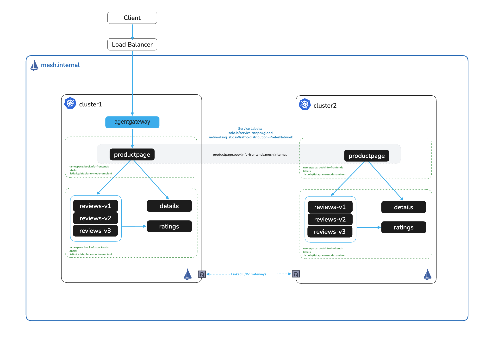

# Kubernetes Ambient Multicluster NodePort Workshop

# Objectives
- Deploy Istio on Kubernetes with Helm based install
- Deploy sample microservices on two different namespaces (bookinfo app)
- Install Istio Ambient Mesh
- Enable Ambient Mesh for app namespaces (bookinfo-frontends and bookinfo-backends)
- Install Solo Enterprise for agentgateway as the ingress gateway, integrated with the ambient mesh, to reach the bookinfo frontend (productpage)
- Peer the two clusters through NodePort east-west gateways, with no LoadBalancer
- Configure a globally available service using labels (productpage)
- Reconfigure ingress to global service hostname (*.<namespace>.mesh.internal)
- Enforce zero trust in both clusters with explicit trust domains, and quarantine a pod or an identity
- Add L7 policy and traffic management with waypoints in both clusters
- Trace and measure the east-west data path, and bypass a central gateway hostname
- Collect mesh metrics from both clusters into one Prometheus and Grafana
- Move a stable hostname between clusters by route weight, under load
- Follow the east-west gateway across nodes, and detect and repair a lost xDS link to a peer
- Serve per-hostname ECDSA P-256 certificates from cert-manager
- Carry the real client IP through the ingress gateway and across clusters
- Send egress through dedicated nodes with stable source IPs
- Convert ingress-nginx and Istio ingress objects to Gateway API
- Upgrade both clusters from 1.28 to 1.29 under load, and roll back
- Add two clusters and peer all four in a full NodePort mesh

# Use Cases
- Zero Trust (mTLS)
- Ingress with agentgateway
- Multi-cluster routing
- Global service discovery
- High Availability
- Failover
- Workload quarantine
- L7 traffic management (waypoints)
- East-west data path and gateway bypass
- Observability and metrics federation
- Hostname migration between clusters
- Peering lifecycle operations
- TLS certificates with cert-manager
- Client source IP preservation
- Egress control with stable IPs
- Ingress migration to Gateway API
- Upgrades and rollback
- Scaling the mesh past two clusters

## NodePort Peering

The clusters peer through east-west gateways exposed as `NodePort` Services, with no LoadBalancer. Solo's `peering` Helm chart creates both sides: the east-west gateway with fixed NodePorts for HBONE (`15008`) and xDS (`15012`), and one remote-peer Gateway per peer cluster that points at a node InternalIP and the xDS NodePort of that peer. The chart turns on Solo's NodePort data plane, a beta feature: istiod learns from each peer which nodes run its east-west gateway, and ztunnel sends cross-cluster HBONE to those nodes. The design fits on-premises and private networks where the nodes of both clusters reach each other directly.

## Ingress

Solo Enterprise for agentgateway is the ingress gateway. It joins the mesh through its Istio integration, so it calls workloads over HBONE with its own SPIFFE identity, and it routes to the global `*.mesh.internal` hostnames. Lab `017` migrates ingress-nginx objects onto it. East-west traffic and waypoints stay on Istio.

## Validated on
- Kubernetes ≥ 1.29
- Istio 1.28.10-patch0-solo
- Solo `peering` Helm chart 1.29.7-patch0-solo, for the east-west and remote-peer Gateways
- Solo Enterprise for agentgateway v2026.9.3, on Gateway API v1.4.1
- vind on Docker Desktop (arm64): two clusters with two nodes each, peered over NodePorts, for every lab
- vind on Docker Desktop (arm64): four clusters with two nodes each for lab `019`
- Istio 1.29.7-patch0-solo as the upgrade target in lab `018`

# High Level Architecture Diagram


## License Key Details
This workshop requires a Solo Trial License Key, exported as `SOLO_TRIAL_LICENSE_KEY` in lab `002`.
Contact your Solo.io account team if you need one. Check the expiry before you start:

```bash
for SEG in $(echo "$SOLO_TRIAL_LICENSE_KEY" | tr '.' ' '); do
  case $(( ${#SEG} % 4 )) in 2) SEG="${SEG}==" ;; 3) SEG="${SEG}=" ;; esac
  EXP=$(printf '%s' "$SEG" | tr '_-' '/+' | base64 -d 2>/dev/null \
        | LC_ALL=C sed -n 's/.*"exp":\([0-9]*\).*/\1/p')
  [ -n "$EXP" ] && break
done

if [ -z "$EXP" ]; then
  echo "Could not read an expiry from SOLO_TRIAL_LICENSE_KEY. Is it set?"
else
  date -d "@$EXP" 2>/dev/null || date -r "$EXP"
fi
```
