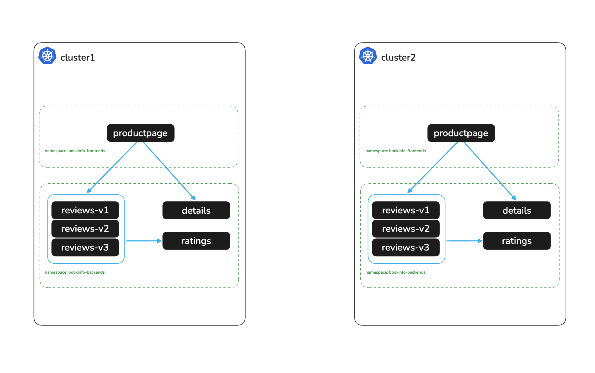

# Deploy Bookinfo Application

# Objectives
- Deploy the bookinfo sample application across two namespaces on cluster1 and cluster2
- Validate the application is accessible via port-forward



## Prerequisites
- This lab assumes you have read through and completed any setup from the `000` labs

Set the context and mesh names for both clusters:
```bash
export KUBECONTEXT_CLUSTER1=cluster1  # Replace with your actual kubectl context name
export MESH_NAME_CLUSTER1=cluster1    # Recommended to keep as cluster1 for POC

export KUBECONTEXT_CLUSTER2=cluster2  # Replace with your actual kubectl context name
export MESH_NAME_CLUSTER2=cluster2    # Recommended to keep as cluster2 for POC
```

## Deploy Bookinfo on both clusters

Deploy the bookinfo frontends and backends in each cluster, and set `CLUSTER_NAME` on reviews so each page shows which cluster served it:
```bash
for C in "$KUBECONTEXT_CLUSTER1=$MESH_NAME_CLUSTER1" "$KUBECONTEXT_CLUSTER2=$MESH_NAME_CLUSTER2"; do
  CTX=${C%%=*}; MESH=${C#*=}
  kubectl apply -f bookinfo/bookinfo-frontends.yaml -f bookinfo/bookinfo-backends.yaml --context $CTX
  kubectl --context $CTX -n bookinfo-backends set env deploy -l app=reviews CLUSTER_NAME=$MESH
done
```

Wait for the applications to be ready:
```bash
for CTX in $KUBECONTEXT_CLUSTER1 $KUBECONTEXT_CLUSTER2; do
  for NS in bookinfo-frontends bookinfo-backends; do
    kubectl --context $CTX -n $NS rollout status deploy --timeout=120s
  done
done
```

## Check the application

Port-forward to productpage in each cluster and request the page:
```bash
for CTX in $KUBECONTEXT_CLUSTER1 $KUBECONTEXT_CLUSTER2; do
  kubectl port-forward svc/productpage -n bookinfo-frontends 9080:9080 --context $CTX >/dev/null &
  PF=$!; sleep 2
  echo "$CTX: $(curl -s -o /dev/null -w '%{http_code}' http://localhost:9080/productpage)"
  kill $PF; wait $PF 2>/dev/null
done
```

Expected output:
```
cluster1: 200
cluster2: 200
```

To browse the page, run `kubectl port-forward svc/productpage -n bookinfo-frontends 9080:9080 --context $KUBECONTEXT_CLUSTER1` and open http://localhost:9080/productpage. Press Ctrl+C when done.

## Next Steps
At this point we have completed the following objectives
- Deployed the bookinfo sample application across two namespaces on cluster1 and cluster2
- Validated the application is accessible via port-forward

In the next step `002` we will install Istio on cluster1
