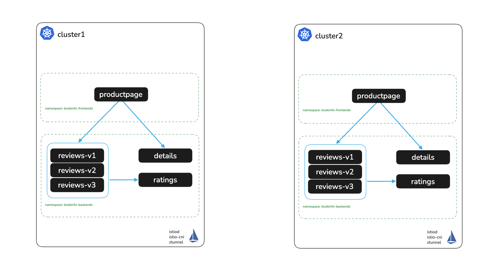

# Install Solo Istio Ambient on cluster2

# Objectives
- Deploy Istio on Kubernetes with Helm based install
- Install Istio Ambient Mesh



## Prerequisites
- This lab assumes you have read through and completed any setup from the `000` labs

## Set cluster contexts
In this workshop, you can use your preferred cluster context. To set it, run the following command, replacing cluster2 with your desired context name
```bash
export KUBECONTEXT_CLUSTER2=cluster2  # Replace with your actual kubectl context name
export MESH_NAME_CLUSTER2=cluster2    # Recommended to keep as cluster2 for POC
```

The KinD, Gateway API and GKE notes from lab `002` apply here too. This lab uses the `SOLO_TRIAL_LICENSE_KEY` and `ISTIO_VERSION` from lab `002`:
```bash
[ -n "$SOLO_TRIAL_LICENSE_KEY" ] || echo "WARNING: SOLO_TRIAL_LICENSE_KEY is not set. Export it as in lab 002."
export ISTIO_VERSION=1.28.10-patch0
```

## Create istio-system namespace and shared root trust secret in cluster2
Run this from the workshop directory, where lab `002` wrote `shared-root-trust-secret.yaml`:
```bash
kubectl create namespace istio-system --context $KUBECONTEXT_CLUSTER2 --dry-run=client -o yaml | kubectl apply --context $KUBECONTEXT_CLUSTER2 -f -
kubectl apply -f shared-root-trust-secret.yaml --context $KUBECONTEXT_CLUSTER2
```

## Install Istio using Helm on cluster2

Install istio-base
```bash
helm upgrade --kube-context $KUBECONTEXT_CLUSTER2 --install istio-base oci://us-docker.pkg.dev/soloio-img/istio-helm/base -n istio-system --version $ISTIO_VERSION-solo --create-namespace

kubectl label namespace istio-system topology.istio.io/network=$MESH_NAME_CLUSTER2 --overwrite --context $KUBECONTEXT_CLUSTER2
```

Install the Gateway API CRDs if they are missing:
```bash
kubectl get crd gateways.gateway.networking.k8s.io --context $KUBECONTEXT_CLUSTER2 &> /dev/null || \
  { kubectl --context $KUBECONTEXT_CLUSTER2 apply -f https://github.com/kubernetes-sigs/gateway-api/releases/download/v1.4.1/standard-install.yaml; }
```

> **GKE only:**
> ```bash
> kubectl apply -f gke/resourcequota.yaml --context $KUBECONTEXT_CLUSTER2
> ```

> **Cilium with kube-proxy replacement:** the istio-cni values below stay the same. Before you install istio-cni, check the Cilium settings ambient needs:
> ```bash
> kubectl -n kube-system get cm cilium-config --context $KUBECONTEXT_CLUSTER2 -o jsonpath='{.data}' | tr ',' '\n' \
>   | grep -E '"(kube-proxy-replacement|bpf-lb-sock-hostns-only|cni-exclusive|enable-bpf-masquerade)"'
> ```
> Expected output (`enable-bpf-masquerade` is absent or `"false"`):
> ```
> "bpf-lb-sock-hostns-only":"true"
> "cni-exclusive":"false"
> "kube-proxy-replacement":"true"
> ```
> If a value differs, set it in the Cilium Helm values and upgrade the Cilium release:
> ```yaml
> cni:
>   exclusive: false          # keeps the istio-cni plugin in Cilium's chained CNI config
> socketLB:
>   hostNamespaceOnly: true   # pods keep the Service IP, so ztunnel picks the endpoint
> bpf:
>   masquerade: false         # the default. eBPF masquerading breaks ambient health probes
> ```
> With `cni.exclusive=true`, Cilium removes the istio-cni plugin from the CNI config, and new pods start without ztunnel redirection.
>
> Sources: Istio [platform prerequisites for Cilium](https://istio.io/latest/docs/ambient/install/platform-prerequisites/#cilium) and Cilium [Istio integration](https://docs.cilium.io/en/stable/network/servicemesh/istio/).

Install istio-cni

> **GKE users:** Uncomment `platform: gke` under `global` in the values below before running this command.

```bash
helm upgrade --kube-context $KUBECONTEXT_CLUSTER2 --install istio-cni oci://us-docker.pkg.dev/soloio-img/istio-helm/cni \
-n istio-system \
--version=$ISTIO_VERSION-solo \
-f -<<EOF
profile: ambient
ambient:
  dnsCapture: true
excludeNamespaces:
  - istio-system
  - kube-system
global:
  # uncomment if using GKE
  #platform: gke
  hub: us-docker.pkg.dev/soloio-img/istio
  tag: $ISTIO_VERSION-solo
  variant: distroless
EOF
```

Wait for rollout to complete
```bash
kubectl rollout status ds/istio-cni-node -n istio-system --watch --timeout=90s --context $KUBECONTEXT_CLUSTER2
```

Install istiod
```bash
helm upgrade --kube-context $KUBECONTEXT_CLUSTER2 --install istiod oci://us-docker.pkg.dev/soloio-img/istio-helm/istiod \
-n istio-system \
--version=$ISTIO_VERSION-solo \
-f -<<EOF
profile: ambient
global:
  hub: us-docker.pkg.dev/soloio-img/istio
  tag: $ISTIO_VERSION-solo
  variant: distroless
  multiCluster:
    clusterName: $MESH_NAME_CLUSTER2
  network: $MESH_NAME_CLUSTER2
meshConfig:
  trustDomain: $MESH_NAME_CLUSTER2.local
env:
  # Enables assigning multi-cluster services an IP address
  PILOT_ENABLE_IP_AUTOALLOCATE: "true"
  # Required if you have distinct trust domains per-cluster
  PILOT_SKIP_VALIDATE_TRUST_DOMAIN: "true"
# Required to enable multi-cluster support
platforms:
  peering:
    enabled: true
license:
  value: $SOLO_TRIAL_LICENSE_KEY
EOF
```

Wait for rollout to complete
```bash
kubectl rollout status deploy/istiod -n istio-system --watch --timeout=90s --context $KUBECONTEXT_CLUSTER2
```

Install ztunnel
```bash
helm upgrade --kube-context $KUBECONTEXT_CLUSTER2 --install ztunnel oci://us-docker.pkg.dev/soloio-img/istio-helm/ztunnel \
-n istio-system \
--version=$ISTIO_VERSION-solo \
-f -<<EOF
profile: ambient
logLevel: info
global:
  hub: us-docker.pkg.dev/soloio-img/istio
  tag: $ISTIO_VERSION-solo
  variant: distroless
resources:
  requests:
      cpu: 500m
      memory: 2048Mi
istioNamespace: istio-system
env:
  L7_ENABLED: "true"
  # Required if you have distinct trust domains per-cluster
  SKIP_VALIDATE_TRUST_DOMAIN: "true"
# Must match the setting during Istio installation
network: $MESH_NAME_CLUSTER2
multiCluster:
  clusterName: $MESH_NAME_CLUSTER2
EOF
```

Wait for rollout to complete
```bash
kubectl rollout status ds/ztunnel -n istio-system --watch --timeout=90s --context $KUBECONTEXT_CLUSTER2
```

## Validate the installation
```bash
kubectl get pods -n istio-system --context $KUBECONTEXT_CLUSTER2
```

Expected output:
```
NAME                      READY   STATUS    RESTARTS   AGE
istio-cni-node-6pntk      1/1     Running   0          14s
istio-cni-node-ksccv      1/1     Running   0          14s
istiod-78f896bd9b-n7jj5   1/1     Running   0          7s
ztunnel-572zg             1/1     Running   0          2s
ztunnel-fknlh             1/1     Running   0          2s
```

## Next Steps
At this point we have completed the following objectives
- Deployed Istio on Kubernetes with Helm based install on cluster2
- Installed Istio Ambient Mesh on cluster2

In the next step `004` we will enroll the bookinfo namespaces into the Ambient Mesh
