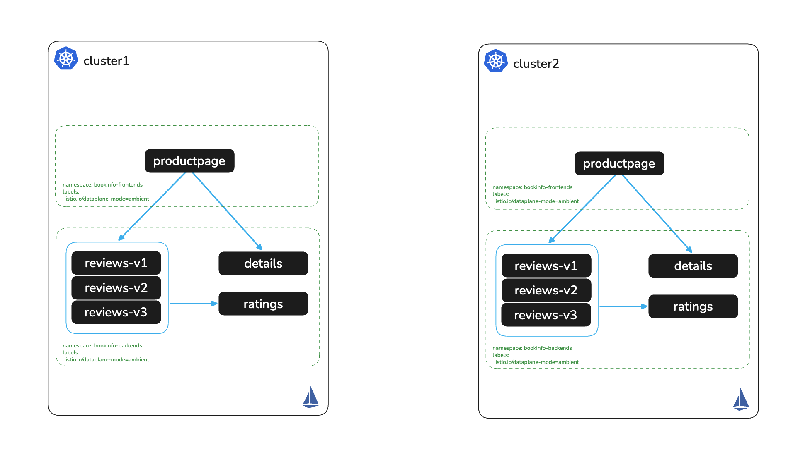

# Enroll Apps in the Mesh

# Objectives
- Enroll the bookinfo namespaces into Ambient Mesh on cluster1 and cluster2
- Validate workloads are enrolled in the mesh using `istioctl`



## Prerequisites
- This lab assumes you have completed setup from labs `000-003`

Ensure the following environment variables are set:
```bash
export KUBECONTEXT_CLUSTER1=cluster1  # Replace with your actual kubectl context name

export KUBECONTEXT_CLUSTER2=cluster2  # Replace with your actual kubectl context name
```

## Background

In ambient mode, one namespace label enrolls a workload. ztunnel on each node takes over the pod traffic and adds mTLS. Pods do not restart and manifests do not change.

## Enroll Apps to Ambient Mesh on cluster1

Before enrolling, check the current workload status for the bookinfo namespaces. The protocol is `TCP`, so the workloads are not in the mesh yet:
```bash
./solo-istioctl zc workloads -n istio-system --context $KUBECONTEXT_CLUSTER1 | grep -E "^NAMESPACE|bookinfo"
```

Expected output:
```
NAMESPACE          POD NAME                                ADDRESS    NODE     WAYPOINT PROTOCOL
bookinfo-backends  details-v1-74658b4f9b-w4bt8             10.244.2.3 worker-1 None     TCP
bookinfo-backends  ratings-v1-5d896f87b-5jfp5              10.244.0.4 cluster1 None     TCP
bookinfo-backends  reviews-v1-78b6cf6d-s5wmm               10.244.2.6 worker-1 None     TCP
bookinfo-backends  reviews-v2-8dbdc6fdd-27ckx              10.244.0.6 cluster1 None     TCP
bookinfo-backends  reviews-v3-59958c554d-h66vv             10.244.0.7 cluster1 None     TCP
bookinfo-frontends productpage-v1-59c74584cf-rcncg         10.244.2.2 worker-1 None     TCP
```

Enable ambient with namespace label
```bash
kubectl label namespace bookinfo-frontends istio.io/dataplane-mode=ambient --context $KUBECONTEXT_CLUSTER1
kubectl label namespace bookinfo-backends istio.io/dataplane-mode=ambient --context $KUBECONTEXT_CLUSTER1
```

Check workload status again. Once ztunnel picks up the label, the protocol is `HBONE` and ztunnel encrypts the traffic with mTLS:
```bash
for i in $(seq 1 15); do
  ./solo-istioctl zc workloads -n istio-system --context $KUBECONTEXT_CLUSTER1 | grep bookinfo | grep -q " TCP" || break; sleep 2
done
./solo-istioctl zc workloads -n istio-system --context $KUBECONTEXT_CLUSTER1 | grep -E "^NAMESPACE|bookinfo"
```

Expected output:
```
NAMESPACE          POD NAME                                ADDRESS    NODE     WAYPOINT PROTOCOL
bookinfo-backends  details-v1-74658b4f9b-w4bt8             10.244.2.3 worker-1 None     HBONE
bookinfo-backends  ratings-v1-5d896f87b-5jfp5              10.244.0.4 cluster1 None     HBONE
bookinfo-backends  reviews-v1-78b6cf6d-s5wmm               10.244.2.6 worker-1 None     HBONE
bookinfo-backends  reviews-v2-8dbdc6fdd-27ckx              10.244.0.6 cluster1 None     HBONE
bookinfo-backends  reviews-v3-59958c554d-h66vv             10.244.0.7 cluster1 None     HBONE
bookinfo-frontends productpage-v1-59c74584cf-rcncg         10.244.2.2 worker-1 None     HBONE
```

## Enroll Apps to Ambient Mesh on cluster2

Enable ambient with namespace label
```bash
kubectl label namespace bookinfo-frontends istio.io/dataplane-mode=ambient --context $KUBECONTEXT_CLUSTER2
kubectl label namespace bookinfo-backends istio.io/dataplane-mode=ambient --context $KUBECONTEXT_CLUSTER2
```

## Check both clusters
```bash
for CTX in $KUBECONTEXT_CLUSTER1 $KUBECONTEXT_CLUSTER2; do
  echo "$CTX: $(./solo-istioctl zc workloads -n istio-system --context $CTX | grep bookinfo | grep -c HBONE)/6 bookinfo workloads on HBONE"
done
```

Expected output:
```
cluster1: 6/6 bookinfo workloads on HBONE
cluster2: 6/6 bookinfo workloads on HBONE
```

## Next Steps
At this point we have completed the following objectives:
- Enrolled the bookinfo namespaces into Ambient Mesh on cluster1 and cluster2
- Validated workloads are enrolled in the mesh using `istioctl zc workloads`

In the next step `005` we will install agentgateway as the ingress gateway on cluster1
