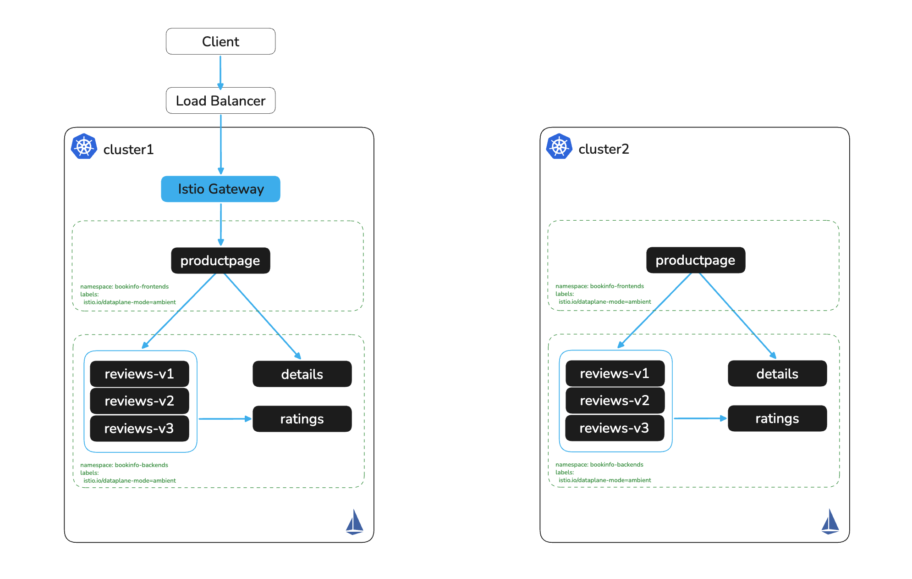

# Expose Bookinfo on cluster1

# Objectives
- Deploy an Istio Ingress Gateway on cluster1
- Expose the bookinfo application via an HTTPRoute



## Prerequisites
- This lab assumes you have completed setup from labs `000-004`

## Set cluster contexts
```bash
export KUBECONTEXT_CLUSTER1=cluster1  # Replace with your actual kubectl context name
```

## Configure Ingress Gateway and Expose Application on cluster1

Deploy an Istio Ingress Gateway. The `networking.istio.io/service-type` annotation sets the type of the `ingress-istio` Service that Istio creates. This lab uses `LoadBalancer`. Only the east-west gateways in lab `006` must be `NodePort`.
```bash
kubectl apply --context $KUBECONTEXT_CLUSTER1 -f - <<EOF
apiVersion: gateway.networking.k8s.io/v1
kind: Gateway
metadata:
  name: ingress
  namespace: istio-system
  annotations:
    # Change to NodePort if your cluster has no LoadBalancer integration
    networking.istio.io/service-type: LoadBalancer
spec:
  gatewayClassName: istio
  listeners:
  - name: http
    port: 80
    protocol: HTTP
    allowedRoutes:
      namespaces:
        from: All
EOF
```

> **Note:** If your cloud provider requires specific load balancer annotations (for example, to use an NLB on AWS), you can customize the gateway's generated service using `spec.infrastructure.parametersRef`. Replace the command above with the following, which includes a `gw-options` ConfigMap:
>
> ```bash
> kubectl apply --context $KUBECONTEXT_CLUSTER1 -f - <<EOF
> apiVersion: gateway.networking.k8s.io/v1
> kind: Gateway
> metadata:
>   name: ingress
>   namespace: istio-system
>   annotations:
>     networking.istio.io/service-type: LoadBalancer
> spec:
>   infrastructure:
>     parametersRef:
>       group: ""
>       kind: ConfigMap
>       name: gw-options
>   gatewayClassName: istio
>   listeners:
>   - name: http
>     port: 80
>     protocol: HTTP
>     allowedRoutes:
>       namespaces:
>         from: All
> ---
> apiVersion: v1
> kind: ConfigMap
> metadata:
>   name: gw-options
>   namespace: istio-system
> data:
>   service: |
>     metadata:
>       annotations:
>         service.beta.kubernetes.io/aws-load-balancer-type: "nlb"
> EOF
> ```

> **Note:** If your environment requires TLS termination at the gateway (port 443), first store your certificate and key in a Kubernetes Secret:
>
> ```bash
> kubectl create secret tls https \
>   --cert=path/to/cert.pem \
>   --key=path/to/key.pem \
>   -n istio-system --context $KUBECONTEXT_CLUSTER1
> ```
>
> Then replace the `listeners` block in the Gateway with an HTTPS listener:
>
> ```yaml
> listeners:
> - name: https
>   port: 443
>   protocol: HTTPS
>   tls:
>     mode: Terminate
>     certificateRefs:
>     - name: https
>       kind: Secret
>   allowedRoutes:
>     namespaces:
>       from: All
> ```

Wait for the gateway to be programmed, then check the pod and Service
```bash
kubectl wait --for=condition=Programmed gateway/ingress -n istio-system --timeout=120s --context $KUBECONTEXT_CLUSTER1
kubectl rollout status deploy/ingress-istio -n istio-system --watch --timeout=90s --context $KUBECONTEXT_CLUSTER1
kubectl get pods -n istio-system --context $KUBECONTEXT_CLUSTER1
kubectl get svc -n istio-system --context $KUBECONTEXT_CLUSTER1
```

Expected output (pod suffixes and addresses differ on your machine):
```
NAME                            READY   STATUS    RESTARTS   AGE
ingress-istio-76f9d79d4-tqrx2   1/1     Running   0          10s
istio-cni-node-4swmm            1/1     Running   0          9m23s
istio-cni-node-pwspx            1/1     Running   0          9m23s
istiod-55ddf67c4f-4bjxj         1/1     Running   0          9m20s
ztunnel-cqfgc                   1/1     Running   0          9m16s
ztunnel-wc6c9                   1/1     Running   0          9m16s
NAME            TYPE           CLUSTER-IP       EXTERNAL-IP      PORT(S)                                 AGE
ingress-istio   LoadBalancer   10.103.147.190   172.30.255.254   15021:30194/TCP,80:30583/TCP            8m51s
istiod          ClusterIP      10.103.248.226   <none>           15010/TCP,15012/TCP,443/TCP,15014/TCP   9m20s
```

> **Note:** The cloud load balancer may take a few minutes to be provisioned. If `EXTERNAL-IP` shows `<pending>`, wait and re-run the `kubectl get svc` command until an address is assigned before proceeding.

Expose the bookinfo application using an HTTPRoute
```bash
kubectl apply --context $KUBECONTEXT_CLUSTER1 -f - <<EOF
apiVersion: gateway.networking.k8s.io/v1
kind: HTTPRoute
metadata:
  name: bookinfo-route
  namespace: bookinfo-frontends
spec:
  parentRefs:
    - name: ingress
      namespace: istio-system
  rules:
    - matches:
      - path:
          type: PathPrefix
          value: /
      backendRefs:
      - name: productpage
        port: 9080
EOF
```

## Reach the ingress gateway

Read the load balancer address into `INGRESS_ADDR`. Lab `006` reuses it for every request. AWS returns a hostname and most other providers return an IP, so the jsonpath reads either.
```bash
export INGRESS_ADDR=$(kubectl get svc ingress-istio -n istio-system \
  --context $KUBECONTEXT_CLUSTER1 -o jsonpath="{.status.loadBalancer.ingress[0]['hostname','ip']}")
if [ -z "$INGRESS_ADDR" ]; then
  echo "⚠️  No external LoadBalancer address available. Use the NodePort or port-forward option below."
else
  echo http://$INGRESS_ADDR/productpage
fi
```

Navigate to the printed URL in your browser, or verify with curl
```bash
curl -s http://$INGRESS_ADDR/productpage | grep -o "<title>.*</title>"
```

Expected output:
```
<title>Simple Bookstore App</title>
```

### No LoadBalancer? Use NodePort

If you set `networking.istio.io/service-type: NodePort` on the Gateway, build the address from the IP of the node that runs the gateway pod and the NodePort for port 80:
```bash
INGRESS_HOST=$(kubectl get pods -n istio-system -l gateway.networking.k8s.io/gateway-name=ingress \
  --context $KUBECONTEXT_CLUSTER1 -o jsonpath='{.items[0].status.hostIP}')
INGRESS_PORT=$(kubectl get svc ingress-istio -n istio-system \
  --context $KUBECONTEXT_CLUSTER1 -o jsonpath='{.spec.ports[?(@.port==80)].nodePort}')
export INGRESS_ADDR=$INGRESS_HOST:$INGRESS_PORT
curl -s http://$INGRESS_ADDR/productpage | grep -o "<title>.*</title>"
```

### Host cannot reach the gateway address? Use port-forward

Laptops outside the cluster network often cannot reach a private load balancer or node InternalIPs, so the curl above times out. Port-forward to the ingress gateway Service instead, and leave it running in a separate terminal:
```bash
kubectl port-forward svc/ingress-istio -n istio-system 8080:80 --context $KUBECONTEXT_CLUSTER1
```

Then point `INGRESS_ADDR` at the forwarded port and run the same curl
```bash
export INGRESS_ADDR=localhost:8080
curl -s http://$INGRESS_ADDR/productpage | grep -o "<title>.*</title>"
```

> **Why forward to the gateway and not to productpage?** In lab `006` the gateway routes to cluster2 when productpage on cluster1 is down. A port-forward to `svc/productpage` skips the gateway, so the failover test would fail.

## Next Steps
At this point we have completed the following objectives
- Deployed an Istio Ingress Gateway on cluster1
- Exposed the bookinfo application via an HTTPRoute

In the next step `006` we will peer the two clusters over NodePort and configure failover
