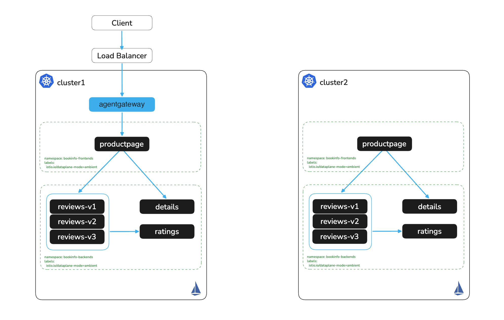

# Expose Bookinfo on cluster1

# Objectives
- Expose the bookinfo application through the agentgateway ingress gateway with an HTTPRoute
- Read the gateway address into `INGRESS_ADDR` for the later labs



## Prerequisites
- This lab assumes you have completed setup from labs `000-005`

## Set cluster contexts
```bash
export KUBECONTEXT_CLUSTER1=cluster1  # Replace with your actual kubectl context name
```

## Expose Application on cluster1

The `ingress` Gateway from lab `005` accepts routes from every namespace. Attach an HTTPRoute for productpage to it:
```bash
kubectl apply --context $KUBECONTEXT_CLUSTER1 -f - <<EOF
apiVersion: gateway.networking.k8s.io/v1
kind: HTTPRoute
metadata:
  name: bookinfo-route
  namespace: bookinfo-frontends
spec:
  parentRefs:
    - name: ingress
      namespace: agentgateway-system
  rules:
    - matches:
      - path:
          type: PathPrefix
          value: /
      backendRefs:
      - name: productpage
        port: 9080
EOF
```

## Reach the ingress gateway

Read the load balancer address into `INGRESS_ADDR`. Lab `007` reuses it for every request.
```bash
export INGRESS_ADDR=$(kubectl get svc ingress -n agentgateway-system \
  --context $KUBECONTEXT_CLUSTER1 -o jsonpath="{.status.loadBalancer.ingress[0]['hostname','ip']}")
if [ -z "$INGRESS_ADDR" ]; then
  echo "WARNING: No external LoadBalancer address available. Use the NodePort or port-forward option below, and skip the next curl."
else
  echo http://$INGRESS_ADDR/productpage
fi
```

Navigate to the printed URL in your browser, or verify with curl
```bash
curl -s http://$INGRESS_ADDR/productpage | grep -o "<title>.*</title>"
```

Expected output:
```
<title>Simple Bookstore App</title>
```

### No LoadBalancer? Use NodePort

If you set `type: NodePort` in the `ingress-config` parameters in lab `005`, build the address from the IP of the node that runs the gateway pod and the NodePort for port 80:
```bash
INGRESS_HOST=$(kubectl get pods -n agentgateway-system -l gateway.networking.k8s.io/gateway-name=ingress \
  --context $KUBECONTEXT_CLUSTER1 -o jsonpath='{.items[0].status.hostIP}')
INGRESS_PORT=$(kubectl get svc ingress -n agentgateway-system \
  --context $KUBECONTEXT_CLUSTER1 -o jsonpath='{.spec.ports[?(@.port==80)].nodePort}')
export INGRESS_ADDR=$INGRESS_HOST:$INGRESS_PORT
curl -s http://$INGRESS_ADDR/productpage | grep -o "<title>.*</title>"
```

### Host cannot reach the gateway address? Use port-forward

Laptops outside the cluster network often cannot reach a private load balancer or node InternalIPs, so the curl above times out. Port-forward to the ingress gateway Service instead, and leave it running in a separate terminal:
```bash
kubectl port-forward svc/ingress -n agentgateway-system 8080:80 --context $KUBECONTEXT_CLUSTER1
```

Then point `INGRESS_ADDR` at the forwarded port and run the same curl
```bash
export INGRESS_ADDR=localhost:8080
curl -s http://$INGRESS_ADDR/productpage | grep -o "<title>.*</title>"
```

> **Why forward to the gateway and not to productpage?** In lab `007` the gateway routes to cluster2 when productpage on cluster1 is down. A port-forward to `svc/productpage` skips the gateway, so the failover test would fail.

## Next Steps
At this point we have completed the following objectives
- Exposed the bookinfo application through the agentgateway ingress gateway with an HTTPRoute
- Read the gateway address into `INGRESS_ADDR` for the later labs

In the next step `007` we will peer the two clusters over NodePort and configure failover
