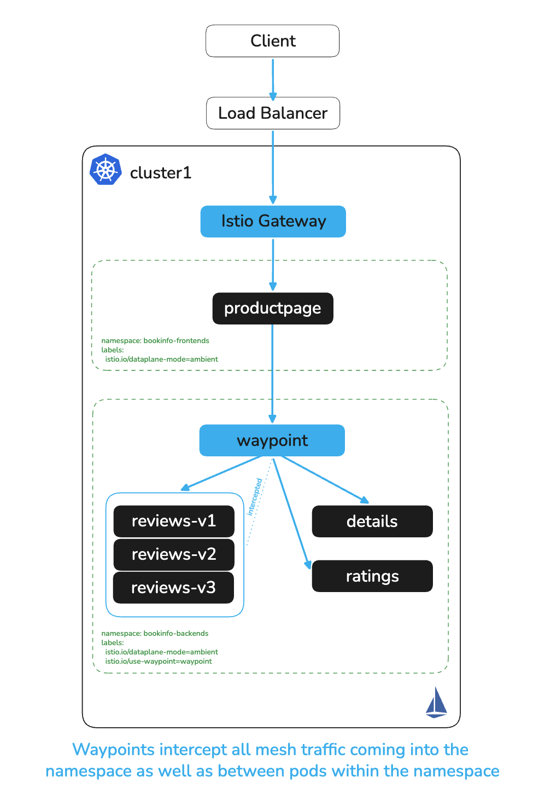
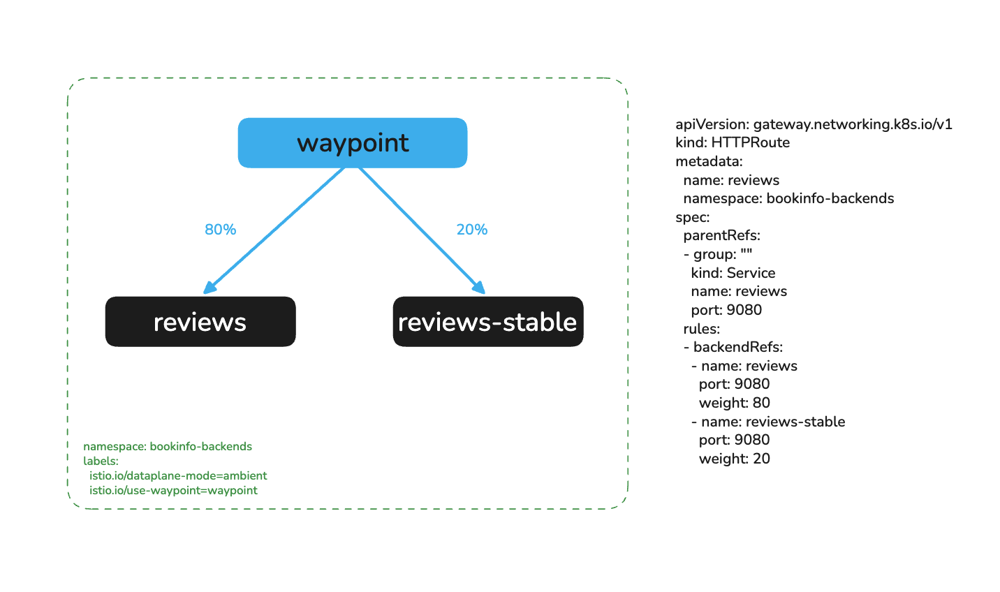
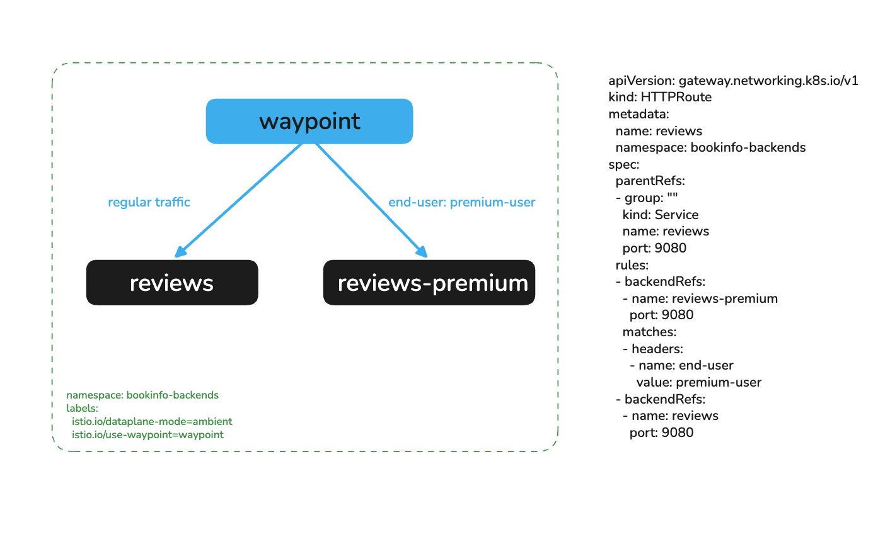
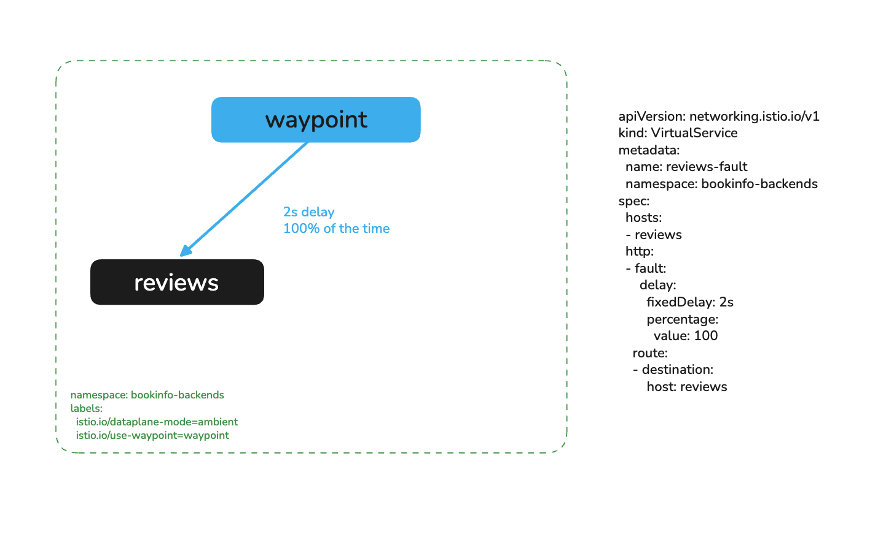
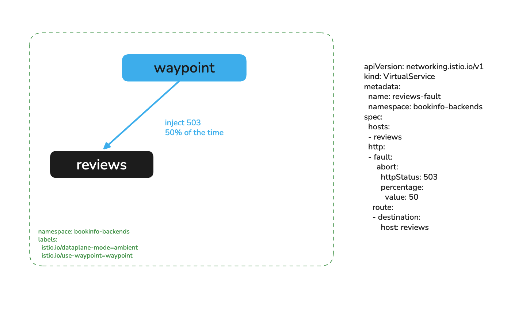

# Add L7 Policy and Traffic Management with Waypoints

# Objectives
- Deploy a namespace waypoint for `bookinfo-backends` in both clusters
- Move the lab `008` identity rules onto the waypoint, so they keep working through the extra hop
- Restrict `reviews` to `GET` requests with an L7 AuthorizationPolicy
- Shift traffic between `reviews` versions by weight and by request header
- Inject delays and aborts, and absorb a broken replica with retries



## Prerequisites
- This lab assumes you have completed setup from labs `000-008`
- The lab `008` deny-all baseline and allow policies are in place in both clusters

Ensure the following environment variables are set:
```bash
export KUBECONTEXT_CLUSTER1=cluster1  # Replace with your actual kubectl context name
export KUBECONTEXT_CLUSTER2=cluster2  # Replace with your actual kubectl context name
[ -n "$INGRESS_ADDR" ] || echo "WARNING: INGRESS_ADDR is not set. Run the 'Reach the ingress gateway' block from lab 006 in this shell, or its port-forward fallback."
```

## Background

ztunnel handles L4 for every enrolled workload: mTLS, identity and connection-level authorization. It does not parse HTTP, so it cannot match a method or a path, split requests by weight, or retry a failed request. A waypoint adds those L7 features. It is an Envoy proxy that you create with a Gateway API `Gateway` of class `istio-waypoint`, and it serves the namespaces or services that you label to use it.

A waypoint is a destination-side proxy. Callers keep their direct ztunnel path to everything else, and only traffic to the labelled services takes the extra hop. Lab `010` measures what that hop costs.

| Concern | Where it runs in this lab |
|---|---|
| mTLS and identity | ztunnel, as before |
| Identity rules for `bookinfo-backends` | The waypoint, which sees the original caller |
| HTTP method rules, weighted routes, header routes, faults, retries | The waypoint |

> **Why a waypoint in both clusters?** Waypoint configuration is per cluster, like the policies in lab `008`. If only cluster1 had the waypoint, the cluster2 backends would still enforce the lab `008` L4 rules, and an L7 rule such as "GET only" would apply in one cluster and not the other. Deploy the waypoint and its security policies in every cluster. Traffic experiments, such as the canary routes below, can stay in one cluster.

## Deploy a Waypoint in Both Clusters

Create a waypoint for `bookinfo-backends` in each cluster, and label the namespace so that its services use it:
```bash
for context in $KUBECONTEXT_CLUSTER1 $KUBECONTEXT_CLUSTER2; do
  kubectl apply --context $context -f - <<EOF
apiVersion: gateway.networking.k8s.io/v1
kind: Gateway
metadata:
  name: waypoint
  namespace: bookinfo-backends
spec:
  gatewayClassName: istio-waypoint
  listeners:
  - name: mesh
    port: 15008
    protocol: HBONE
    allowedRoutes:
      namespaces:
        from: All
EOF
  kubectl rollout status deploy/waypoint -n bookinfo-backends --watch --timeout=90s --context $context
  kubectl label namespace bookinfo-backends istio.io/use-waypoint=waypoint --overwrite --context $context
done
```

Check that ztunnel now sends `bookinfo-backends` services through the waypoint:
```bash
./solo-istioctl zc services -n istio-system --context $KUBECONTEXT_CLUSTER1 | grep -E "NAMESPACE|bookinfo-backends"
```

Expected output:
```
NAMESPACE          SERVICE NAME                           SERVICE VIP           WAYPOINT ENDPOINTS
bookinfo-backends  details                                10.98.154.121         waypoint 1/1
bookinfo-backends  ratings                                10.108.150.79         waypoint 1/1
bookinfo-backends  reviews                                10.109.243.178        waypoint 3/3
bookinfo-backends  waypoint                               10.97.26.3            None     1/1
```

## Move the Identity Rules onto the Waypoint

Reload the productpage:
```bash
curl -s http://$INGRESS_ADDR/productpage | grep -oE "cluster[12]|Error fetching[^<]*" | sort | uniq -c
```

Expected output:
```
   1 Error fetching product details
   1 Error fetching product reviews
```

The waypoint changed the traffic path. productpage now connects to the waypoint, and the waypoint connects to the `details` pod. The ztunnel in front of `details` sees `bookinfo-backends/sa/waypoint` as the caller, and the lab `008` policies only allow `bookinfo-frontends/sa/bookinfo-productpage`, so ztunnel denies every backend call.

Split enforcement across the two hops. The comment at the top of the file explains each part:
```bash
sed -n '1,17p' auth-policy/waypoint-auth.yaml
for context in $KUBECONTEXT_CLUSTER1 $KUBECONTEXT_CLUSTER2; do
  kubectl apply -f auth-policy/waypoint-auth.yaml --context $context
done
sleep 3
curl -s http://$INGRESS_ADDR/productpage | grep -oE "cluster[12]|Error fetching[^<]*" | sort | uniq -c
```

Expected output:
```
   2 cluster1
```

Check that the rules still hold. `reviews` may call `ratings`, and only productpage may call `details`:
```bash
kubectl exec deploy/reviews-v2 -n bookinfo-backends --context $KUBECONTEXT_CLUSTER1 -- \
  curl -s -o /dev/null -w "reviews -> ratings: %{http_code}\n" http://ratings:9080/ratings/0
kubectl exec deploy/ratings-v1 -n bookinfo-backends --context $KUBECONTEXT_CLUSTER1 -- \
  curl -s -w " (%{http_code})\n" http://details:9080/details/0
```

Expected output:
```
reviews -> ratings: 200
RBAC: access denied (403)
```

The denied call now gets a real HTTP `403` with a reason. ztunnel can only reset a connection, so before the waypoint the same call failed with a reset.

## Restrict Reviews to GET

ztunnel matches identities. The waypoint can also match HTTP attributes. Update `reviews-waypoint-auth` in both clusters so productpage may only send `GET` requests to reviews:
```bash
for context in $KUBECONTEXT_CLUSTER1 $KUBECONTEXT_CLUSTER2; do
  kubectl apply --context $context -f - <<EOF
apiVersion: security.istio.io/v1
kind: AuthorizationPolicy
metadata:
  name: reviews-waypoint-auth
  namespace: bookinfo-backends
spec:
  targetRefs:
  - kind: Service
    group: ""
    name: reviews
  action: ALLOW
  rules:
  - from:
    - source:
        principals:
        - cluster1.local/ns/bookinfo-frontends/sa/bookinfo-productpage
        - cluster2.local/ns/bookinfo-frontends/sa/bookinfo-productpage
    to:
    - operation:
        methods: ["GET"]
EOF
done
```

> **Why change the existing policy instead of adding a "GET only" policy?** `ALLOW` policies add up. A second policy that allows `GET` from any caller would let every workload in the mesh read reviews, which undoes the identity rule. Keep the identity and the operation in the same rule.

Turn on access logging for the cluster1 waypoint, so you can see the decision:
```bash
kubectl apply --context $KUBECONTEXT_CLUSTER1 -f - <<EOF
apiVersion: telemetry.istio.io/v1
kind: Telemetry
metadata:
  name: waypoint-access-logging
  namespace: bookinfo-backends
spec:
  targetRefs:
  - kind: Gateway
    group: gateway.networking.k8s.io
    name: waypoint
  accessLogging:
  - providers:
    - name: envoy
EOF
sleep 3
```

productpage has no `curl`, so the requests below run Python inside the productpage container. Send a `GET` and a `DELETE`:
```bash
kubectl exec deploy/productpage-v1 -n bookinfo-frontends --context $KUBECONTEXT_CLUSTER1 -- python3 -c "
import urllib.request, urllib.error
for m in ['GET', 'DELETE']:
    req = urllib.request.Request('http://reviews.bookinfo-backends:9080/reviews/0', method=m)
    try:
        print(m, urllib.request.urlopen(req).getcode())
    except urllib.error.HTTPError as e:
        print(m, e.code, e.read().decode())"
sleep 2
kubectl logs -n bookinfo-backends deploy/waypoint --context $KUBECONTEXT_CLUSTER1 --since=1m \
  | grep DELETE | grep -oE '"DELETE [^"]*" [0-9]+ - [a-z_]+\[[^]]*\]'
```

Expected output:
```
GET 200
DELETE 403 RBAC: access denied
"DELETE /reviews/0 HTTP/1.1" 403 - rbac_access_denied_matched_policy[none]
```

`rbac_access_denied_matched_policy[none]` means no `ALLOW` rule matched the request. The waypoint rejected it before it reached a reviews pod.

## Shift Traffic Between Versions

The waypoint is in the path of every request to reviews, so an `HTTPRoute` attached to the `reviews` Service can choose a backend per request. This section uses two extra Services from `bookinfo/bookinfo-waypoint-services.yaml`:
- `reviews-stable` selects only `reviews-v3` (red stars)
- `reviews-premium` selects only `reviews-v2` (black stars)

The routes in this section run in cluster1 only. productpage in cluster1 calls reviews in cluster1, so that is where the effect is visible. Apply the Services, and pin the `reviews` Service to `v1` so the canary signal is clear:
```bash
kubectl apply -f bookinfo/bookinfo-waypoint-services.yaml --context $KUBECONTEXT_CLUSTER1
kubectl patch svc reviews -n bookinfo-backends --context $KUBECONTEXT_CLUSTER1 \
  --type=merge -p '{"spec":{"selector":{"app":"reviews","version":"v1"}}}'
sleep 3
```

The productpage shows the name of the reviews version that served it. Define a helper that counts versions over 20 requests through the ingress gateway:
```bash
count_reviews_versions() {
  for i in $(seq 1 20); do
    curl -s http://$INGRESS_ADDR/productpage | grep -oE 'reviews-v[123]' | head -1
  done | sort | uniq -c
}
count_reviews_versions
```

Expected output:
```
  20 reviews-v1
```

### Canary at 20 Percent

Send 20 percent of reviews traffic to `reviews-stable`. The `parentRefs` entry is the `reviews` Service, not a Gateway. This attaches the route to the waypoint, and callers keep using `reviews:9080`:
```bash
kubectl apply --context $KUBECONTEXT_CLUSTER1 -f - <<EOF
apiVersion: gateway.networking.k8s.io/v1
kind: HTTPRoute
metadata:
  name: reviews
  namespace: bookinfo-backends
spec:
  parentRefs:
  - group: ""
    kind: Service
    name: reviews
    port: 9080
  rules:
  - backendRefs:
    - name: reviews
      port: 9080
      weight: 80
    - name: reviews-stable
      port: 9080
      weight: 20
EOF
sleep 3
count_reviews_versions
```

Expected output (the split varies from run to run):
```
  16 reviews-v1
   4 reviews-v3
```



Complete the rollout by sending all traffic to `reviews-stable`:
```bash
kubectl patch httproute reviews -n bookinfo-backends --context $KUBECONTEXT_CLUSTER1 --type=json \
  -p '[{"op":"replace","path":"/spec/rules/0/backendRefs","value":[{"name":"reviews-stable","port":9080,"weight":100}]}]'
sleep 3
count_reviews_versions
```

Expected output:
```
  20 reviews-v3
```

### Route Premium Users by Header

Send requests with the header `end-user: premium-user` to `reviews-premium`, and everything else to `reviews`:
```bash
kubectl apply --context $KUBECONTEXT_CLUSTER1 -f - <<EOF
apiVersion: gateway.networking.k8s.io/v1
kind: HTTPRoute
metadata:
  name: reviews
  namespace: bookinfo-backends
spec:
  parentRefs:
  - group: ""
    kind: Service
    name: reviews
    port: 9080
  rules:
  - matches:
    - headers:
      - name: end-user
        value: premium-user
    backendRefs:
    - name: reviews-premium
      port: 9080
  - backendRefs:
    - name: reviews
      port: 9080
EOF
sleep 3
kubectl exec deploy/productpage-v1 -n bookinfo-frontends --context $KUBECONTEXT_CLUSTER1 -- python3 -c "
import urllib.request, json
for h in [{}, {'end-user': 'premium-user'}]:
    req = urllib.request.Request('http://reviews.bookinfo-backends:9080/reviews/0', headers=h)
    r = json.load(urllib.request.urlopen(req))
    print(h, r['podname'], r['reviews'][0].get('rating', {}).get('color'))"
```

Expected output:
```
{} reviews-v1-78b6cf6d-8wrvn None
{'end-user': 'premium-user'} reviews-v2-8dbdc6fdd-fqqmd black
```

The plain request went to `v1`, which shows no stars. The premium request went to `v2`, which shows black stars. In a browser, sign in as `premium-user` with any password: productpage forwards the `end-user` header, and the stars turn black.



Remove the route before the next section:
```bash
kubectl delete httproute reviews -n bookinfo-backends --context $KUBECONTEXT_CLUSTER1 --ignore-not-found
```

## Inject Faults

Fault injection tests how callers behave when a dependency is slow or failing. Gateway API has no fault filter, so this section uses an Istio `VirtualService`, which the waypoint applies for the `reviews` host.

Add a 2 second delay to every request:
```bash
kubectl apply --context $KUBECONTEXT_CLUSTER1 -f - <<EOF
apiVersion: networking.istio.io/v1
kind: VirtualService
metadata:
  name: reviews-fault
  namespace: bookinfo-backends
spec:
  hosts:
  - reviews
  http:
  - fault:
      delay:
        fixedDelay: 2s
        percentage:
          value: 100
    route:
    - destination:
        host: reviews
EOF
sleep 3
kubectl exec deploy/productpage-v1 -n bookinfo-frontends --context $KUBECONTEXT_CLUSTER1 -- python3 -c "
import urllib.request, time
t = time.time()
urllib.request.urlopen('http://reviews.bookinfo-backends:9080/reviews/0')
print(f'Response time: {time.time()-t:.3f}s')"
```

Expected output:
```
Response time: 2.033s
```



Replace the delay with an abort that returns `503` for half of the requests:
```bash
kubectl apply --context $KUBECONTEXT_CLUSTER1 -f - <<EOF
apiVersion: networking.istio.io/v1
kind: VirtualService
metadata:
  name: reviews-fault
  namespace: bookinfo-backends
spec:
  hosts:
  - reviews
  http:
  - fault:
      abort:
        httpStatus: 503
        percentage:
          value: 50
    route:
    - destination:
        host: reviews
EOF
sleep 3
```

Define a helper that sends 20 requests from productpage to reviews and counts the status codes:
```bash
count_reviews_codes() {
  kubectl exec deploy/productpage-v1 -n bookinfo-frontends --context $KUBECONTEXT_CLUSTER1 -- python3 -c "
import urllib.request, urllib.error
for i in range(20):
    try: print(urllib.request.urlopen('http://reviews.bookinfo-backends:9080/reviews/0').getcode())
    except urllib.error.HTTPError as e: print(e.code)" | sort | uniq -c
}
count_reviews_codes
```

Expected output (the split varies from run to run):
```
  13 200
   7 503
```



Remove the fault:
```bash
kubectl delete virtualservice reviews-fault -n bookinfo-backends --context $KUBECONTEXT_CLUSTER1 --ignore-not-found
```

## Absorb a Broken Replica with Retries

A retry policy helps when one replica is broken and the others are healthy. Injected aborts skip retries, so this section breaks a real replica instead. Add a broken replica to the `reviews` Service: a pod with the `app=reviews` and `version=v1` labels that does not listen on port `9080`. It has no readiness probe, so Kubernetes adds it to the Service endpoints:
```bash
kubectl apply --context $KUBECONTEXT_CLUSTER1 -f - <<EOF
apiVersion: apps/v1
kind: Deployment
metadata:
  name: reviews-broken
  namespace: bookinfo-backends
spec:
  replicas: 1
  selector:
    matchLabels:
      app: reviews
      version: v1
      broken: "true"
  template:
    metadata:
      labels:
        app: reviews
        version: v1
        broken: "true"
    spec:
      containers:
      - name: broken
        image: curlimages/curl:8.22.0
        command: ["sleep", "infinity"]
EOF
kubectl rollout status deploy/reviews-broken -n bookinfo-backends --watch --timeout=90s --context $KUBECONTEXT_CLUSTER1
sleep 3
count_reviews_codes
```

Expected output (the split varies from run to run):
```
  12 200
   8 503
```

The waypoint balances across the healthy `reviews-v1` pod and the broken pod, so about half of the requests fail. Add a retry policy for connection failures and `503`s:
```bash
kubectl apply --context $KUBECONTEXT_CLUSTER1 -f - <<EOF
apiVersion: networking.istio.io/v1
kind: VirtualService
metadata:
  name: reviews-retries
  namespace: bookinfo-backends
spec:
  hosts:
  - reviews
  http:
  - retries:
      attempts: 3
      perTryTimeout: 2s
      retryOn: "connect-failure,reset,503"
    route:
    - destination:
        host: reviews
EOF
sleep 3
count_reviews_codes
```

Expected output:
```
  20 200
```

Every request succeeds. When an attempt hits the broken pod, the waypoint retries on another host, so callers never see the failure. Watch the waypoint's retry counters (lab `011`) to find the broken replica.

## Cleanup

Remove the broken replica, the retry policy, the extra Services and the access logging, and restore the `reviews` selector to all versions:
```bash
kubectl delete deploy reviews-broken -n bookinfo-backends --context $KUBECONTEXT_CLUSTER1 --ignore-not-found
kubectl delete virtualservice reviews-retries reviews-fault -n bookinfo-backends --context $KUBECONTEXT_CLUSTER1 --ignore-not-found
kubectl delete httproute reviews -n bookinfo-backends --context $KUBECONTEXT_CLUSTER1 --ignore-not-found
kubectl delete -f bookinfo/bookinfo-waypoint-services.yaml --context $KUBECONTEXT_CLUSTER1 --ignore-not-found
kubectl delete telemetry waypoint-access-logging -n bookinfo-backends --context $KUBECONTEXT_CLUSTER1 --ignore-not-found
kubectl patch svc reviews -n bookinfo-backends --context $KUBECONTEXT_CLUSTER1 \
  --type=merge -p '{"spec":{"selector":{"app":"reviews","version":null}}}'
```

Restore the identity-only `reviews-waypoint-auth` in both clusters:
```bash
for context in $KUBECONTEXT_CLUSTER1 $KUBECONTEXT_CLUSTER2; do
  kubectl apply -f auth-policy/waypoint-auth.yaml --context $context
done
```

The waypoints and `auth-policy/waypoint-auth.yaml` stay in place for the rest of the workshop. Lab `010` measures the waypoint hop, and lab `018` upgrades the waypoints with the rest of the mesh.

> **Removing the waypoints later?** Unlabel the namespace, delete the Gateway, and put the lab `008` pod policies back in each cluster. Callers return to the direct path, where the waypoint-only pod policies would deny them:
> ```bash
> for context in $KUBECONTEXT_CLUSTER1 $KUBECONTEXT_CLUSTER2; do
>   kubectl label namespace bookinfo-backends istio.io/use-waypoint- --context $context
>   kubectl delete gateway waypoint -n bookinfo-backends --context $context --ignore-not-found
>   kubectl delete authorizationpolicy details-waypoint-auth reviews-waypoint-auth ratings-waypoint-auth \
>     -n bookinfo-backends --context $context --ignore-not-found
>   kubectl apply -f auth-policy/details-auth.yaml -f auth-policy/reviews-auth.yaml -f auth-policy/ratings-auth.yaml --context $context
> done
> ```

## Next Steps
At this point we have completed the following objectives:
- Deployed a namespace waypoint for `bookinfo-backends` in both clusters
- Moved the lab `008` identity rules onto the waypoint, so they kept working through the extra hop
- Restricted `reviews` to `GET` requests with an L7 AuthorizationPolicy
- Shifted traffic between `reviews` versions by weight and by request header
- Injected delays and aborts, and absorbed a broken replica with retries

In the next step `010` we will trace the east-west data path and measure each hop
