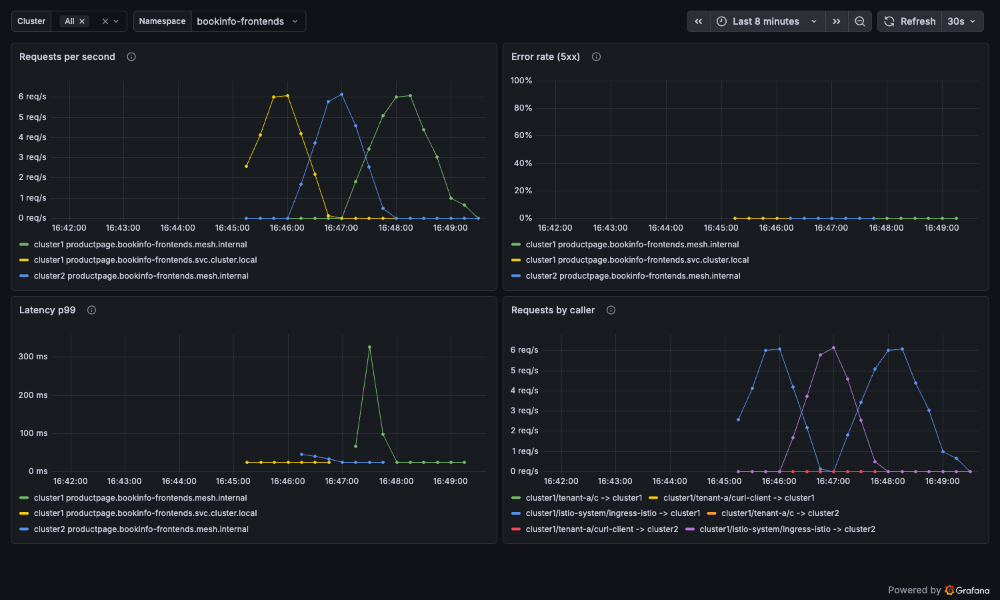

# Collect Mesh Metrics from Every Cluster in One Place

# Objectives
- Scrape only the mesh components, and keep only the series the dashboards use
- Run a central Prometheus in cluster1 and a Prometheus agent with no local database in cluster2
- Send cluster2 metrics to cluster1 over the mesh, with mTLS and an identity-based policy
- Measure the scrape footprint of each cluster
- Give each team a namespace dashboard in Grafana that covers both clusters



## Prerequisites
- This lab assumes you have completed setup from labs `000-009`

Ensure the following environment variables are set:
```bash
export KUBECONTEXT_CLUSTER1=cluster1  # Replace with your actual kubectl context name
export KUBECONTEXT_CLUSTER2=cluster2  # Replace with your actual kubectl context name
[ -n "$INGRESS_ADDR" ] || echo "⚠️  INGRESS_ADDR is not set. Run the 'Reach the ingress gateway' block from lab 005 in this shell, or its port-forward fallback."
```

## Background

A sidecar mesh has one proxy per pod, and every proxy exposes its own metrics, so a Prometheus per cluster has to scrape every pod. In ambient mode, the request metrics come from a few components per cluster:

| Component | Count per cluster | Port and path | What it reports |
|---|---|---|---|
| ztunnel | One per node | `15020` `/metrics` | L4 connections and bytes for every enrolled pod on the node. L7 request counts, codes and latency too, because lab `002` sets `L7_ENABLED: "true"` |
| Waypoints | One per waypoint | `15020` `/stats/prometheus` | L7 metrics for the services that use the waypoint |
| Ingress and east-west gateways | One per gateway | `15020` `/stats/prometheus` | Traffic entering the cluster |
| istiod | One per revision | `15014` `/metrics` | Control plane: config pushes and convergence time |

The number of scrape targets grows with nodes and gateways, not with pods. Each of these components has a `prometheus.io/scrape` annotation, so one scrape job with a namespace filter finds all of them.

This lab builds a two-tier pipeline:

| Cluster | Component | Role |
|---|---|---|
| cluster1 | `prometheus` (server) | Scrapes cluster1, receives remote writes, stores everything, answers queries |
| cluster1 | `grafana` | Dashboards. Queries only the central Prometheus |
| cluster2 | `prometheus` (agent mode) | Scrapes cluster2 and forwards every sample. Keeps a short write-ahead log only |

The manifests are in `observability/`. In each scrape job, `metric_relabel_configs` keeps only the `istio_*` request and TCP series, a few `pilot_*` control plane series, the waypoint retry counter, and process memory and CPU. Prometheus drops everything else the components expose before it stores or forwards a sample. Each job also sets a `cluster` label on every series, so queries and dashboards can tell clusters apart after the data lands in one place.

> **Why send metrics over the mesh?** The agent in cluster2 writes to `prometheus.monitoring.mesh.internal`, the global hostname of the central Prometheus. The writes cross the same east-west NodePort as the rest of the mesh traffic, encrypted with mTLS, and an `AuthorizationPolicy` decides which clusters may write. No extra firewall rule, load balancer or VPC route is needed for metrics. The trade-off: if peering breaks, cluster2 metrics stop arriving while the outage lasts. The agent buffers samples in its write-ahead log (two hours by default) and catches up when the path returns. If your metrics must survive a mesh outage, point `remote_write` at a separate address instead.

## Deploy the Central Prometheus in cluster1

Look at the scrape job and the keep-list, then deploy:
```bash
sed -n '/scrape_configs:/,/regex: "istio_requests_total/p' observability/prometheus-cluster1.yaml
kubectl apply -f observability/prometheus-cluster1.yaml --context $KUBECONTEXT_CLUSTER1
kubectl rollout status deploy/prometheus -n monitoring --watch --timeout=120s --context $KUBECONTEXT_CLUSTER1
```

The `monitoring` namespace is enrolled in the mesh, and the `prometheus` Service carries `solo.io/service-scope=global`. Check that cluster2 now knows the global hostname:
```bash
kubectl get serviceentry autogen.monitoring.prometheus -n istio-system --context $KUBECONTEXT_CLUSTER2
```

Expected output:
```
NAME                            HOSTS                                     LOCATION        RESOLUTION   AGE
autogen.monitoring.prometheus   ["prometheus.monitoring.mesh.internal"]   MESH_INTERNAL   STATIC       13s
```

## Deploy the Prometheus Agent in cluster2

The agent uses the same scrape job with `cluster: cluster2`, runs with `--agent`, and adds one `remote_write` target:
```bash
grep -A2 "remote_write:" observability/prometheus-agent-cluster2.yaml
grep -A3 "\- --agent" observability/prometheus-agent-cluster2.yaml
kubectl apply -f observability/prometheus-agent-cluster2.yaml --context $KUBECONTEXT_CLUSTER2
kubectl rollout status deploy/prometheus -n monitoring --watch --timeout=120s --context $KUBECONTEXT_CLUSTER2
```

Expected output (abridged):
```
    remote_write:
    # The central Prometheus, reached through its global service hostname
    - url: http://prometheus.monitoring.mesh.internal:9090/api/v1/write
        - --agent
        - --storage.agent.path=/prometheus
```

## Allow Only Known Writers

The central Prometheus accepts writes from anyone who can reach it. Allow only Grafana in cluster1 and the agent in cluster2:
```bash
cat observability/prometheus-auth.yaml
kubectl apply -f observability/prometheus-auth.yaml --context $KUBECONTEXT_CLUSTER1
sleep 3
```

Check that another workload is now refused:
```bash
kubectl exec deploy/productpage-v1 -n bookinfo-frontends --context $KUBECONTEXT_CLUSTER1 -- python3 -c "
import urllib.request
try: print(urllib.request.urlopen('http://prometheus.monitoring:9090/-/ready', timeout=5).getcode())
except Exception as e: print('blocked:', e)"
```

Expected output:
```
blocked: [Errno 104] Connection reset by peer
```

The agent's writes carry its identity, `spiffe://cluster2.local/ns/monitoring/sa/prometheus`, across the east-west gateway, so the policy can tell one cluster's writer from another's. Every new cluster's agent gets access when you add its principal to this policy.

## Query Both Clusters from One Place

Send traffic through the ingress gateway so there are request metrics to look at:
```bash
for i in $(seq 1 30); do curl -s -o /dev/null http://$INGRESS_ADDR/productpage; done
```

Port-forward to the central Prometheus. `kubectl port-forward` connects inside the pod, so the policy above does not apply to it:
```bash
kubectl port-forward -n monitoring svc/prometheus 9090:9090 --context $KUBECONTEXT_CLUSTER1 > /dev/null &
PORT_FORWARD_PID=$!
sleep 3
```

Define a helper that runs a query and prints one line per result:
```bash
promql() {
  curl -s localhost:9090/api/v1/query --data-urlencode "query=$1" \
    | grep -oE '"metric":\{[^}]*\},"value":\[[^]]*\]' \
    | sed -E 's/"metric":\{([^}]*)\},"value":\[[^,]*,"([^"]*)"\]/\1 => \2/'
}
```

Wait until the agent's first writes arrive, give both instances time to finish a few scrape rounds, then count the healthy scrape targets in each cluster:
```bash
until promql 'sum by (cluster) (up)' | grep -q cluster2; do sleep 5; done
sleep 45
promql 'sum by (cluster) (up)'
```

Expected output:
```
"cluster":"cluster1" => 9
"cluster":"cluster2" => 8
```

Each cluster has two ztunnels, istiod, one istio-cni pod per node, the east-west gateway, the `bookinfo-backends` waypoint and the Prometheus self-scrape. cluster1 also has the ingress gateway. The istio-cni pods carry the same annotation. Their series do not pass the keep-list, so they cost almost nothing.

Show request rates by reporting cluster:
```bash
promql 'sum by (cluster, reporter) (rate(istio_requests_total[2m]))'
```

Expected output (rates differ on your machine):
```
"cluster":"cluster1","reporter":"source" => 11.228547029710828
"cluster":"cluster1","reporter":"destination" => 11.38095238095238
"cluster":"cluster2","reporter":"destination" => 0
"cluster":"cluster2","reporter":"source" => 0.6857077551642365
"cluster":"cluster1","reporter":"waypoint" => 7.837945943886783
"cluster":"cluster2","reporter":"waypoint" => 0
```

If a reporter is missing from the output, wait 30 seconds and run the query again. `rate()` needs two samples inside the 2-minute window, and a series that appeared in the latest scrape has only one.

The same request can be counted by more than one reporter: the source ztunnel, the waypoint and the destination ztunnel. Pick one per query. The dashboard below uses `reporter="destination"`, which counts each request once, where it was served.

## Measure the Scrape Footprint

Compare how many samples each cluster scrapes with how many it keeps after the keep-list:
```bash
echo "scraped:";  promql 'sum by (cluster) (scrape_samples_scraped{job="mesh"})'
echo "kept:";     promql 'sum by (cluster) (scrape_samples_post_metric_relabeling{job="mesh"})'
echo "memory (MiB):"; promql 'process_resident_memory_bytes{job="prometheus"} / 1024 / 1024'
```

Expected output (numbers differ on your machine):
```
scraped:
"cluster":"cluster1" => 4886
"cluster":"cluster2" => 2270
kept:
"cluster":"cluster1" => 2107
"cluster":"cluster2" => 953
memory (MiB):
"cluster":"cluster2","instance":"localhost:9090","job":"prometheus","namespace":"monitoring" => 130.828125
"cluster":"cluster1","instance":"localhost:9090","job":"prometheus","namespace":"monitoring" => 137.90625
```

Both clusters keep about 43 percent of the samples they scrape, and the rest stays out of storage and off the network. cluster1 keeps more samples because it serves more traffic. Most kept samples are latency histogram buckets (`istio_request_duration_milliseconds_bucket`), and their count grows with the number of distinct caller and service pairs, so watch that series as the mesh grows and aggregate it with recording rules if you need fewer series.

The agent and the server use similar memory in a small lab. The agent only scrapes and forwards: storage, retention and queries all happen in cluster1, so the central tier is the only one you size for them.

Stop the port-forward:
```bash
kill $PORT_FORWARD_PID
```

## Give Each Team a Namespace Dashboard

Load the dashboard JSON into a ConfigMap, and deploy Grafana with Prometheus as its data source:
```bash
kubectl create configmap grafana-dashboards -n monitoring --from-file=observability/mesh-dashboard.json \
  --context $KUBECONTEXT_CLUSTER1 --dry-run=client -o yaml | kubectl apply --context $KUBECONTEXT_CLUSTER1 -f -
kubectl apply -f observability/grafana.yaml --context $KUBECONTEXT_CLUSTER1
kubectl rollout status deploy/grafana -n monitoring --watch --timeout=180s --context $KUBECONTEXT_CLUSTER1
```

Generate traffic for two minutes in the background, and fail productpage over to cluster2 halfway through so both clusters serve requests:
```bash
for i in $(seq 1 1200); do curl -s -o /dev/null http://$INGRESS_ADDR/productpage; sleep 0.1; done &
LOAD_PID=$!
sleep 60
kubectl scale deploy/productpage-v1 -n bookinfo-frontends --replicas 0 --context $KUBECONTEXT_CLUSTER1
sleep 60
kubectl scale deploy/productpage-v1 -n bookinfo-frontends --replicas 1 --context $KUBECONTEXT_CLUSTER1
kubectl rollout status deploy/productpage-v1 -n bookinfo-frontends --watch --timeout=90s --context $KUBECONTEXT_CLUSTER1
wait $LOAD_PID
```

Port-forward to Grafana and open the dashboard. Grafana allows anonymous viewers in this workshop:
```bash
kubectl port-forward -n monitoring svc/grafana 3000:3000 --context $KUBECONTEXT_CLUSTER1 > /dev/null &
GRAFANA_PID=$!
sleep 3
echo "http://localhost:3000/d/mesh-namespace/mesh-namespace-overview?var-namespace=bookinfo-frontends"
```


The dashboard has two variables: **Cluster** and **Namespace**. With **Cluster** set to `All`, the panels show productpage served by cluster1, then by cluster2 during the failover, then by cluster1 again. **Requests by caller** shows who calls the namespace, including callers in other clusters. Every panel filters on `destination_workload_namespace`, so a team sees only the services in its namespace.

> **Tenant-facing dashboards.** To give a team its own view, copy the dashboard into a Grafana folder that only the team can read, and set the `namespace` variable to a constant with the team's namespace. The queries stay the same. For a hard boundary between tenants, also put a query proxy that enforces a label (for example `prom-label-proxy`) between Grafana and Prometheus, so a hand-written query cannot read another namespace.

Stop the port-forward when you are done:
```bash
kill $GRAFANA_PID
```

## Scale the Pattern to a Fleet

The two-tier shape stays the same with hundreds of clusters:

- Each workload cluster runs only the agent. Its cost grows with the nodes and gateways in that cluster, because ambient scrapes ztunnel per node and each gateway, and leaves application pods alone.
- The central tier holds all the state. Replace the single central Prometheus with a remote-write receiver built for many writers and long retention, such as Thanos Receive, Mimir or Cortex. The agents change only their `remote_write` URL.
- The keep-list controls most of the cost. Review it with the dashboard and alert owners, because each series you add is multiplied by the number of clusters.
- Remote write sends each sample once, compressed. If the central tier is in another region or account, the cloud provider bills the metrics traffic as cross-zone or cross-region data, so keep the keep-list short and run one central tier per region if the bill matters.

## Cleanup

No cleanup is needed. The monitoring stack stays in place for lab `017`, where it shows error rates during the upgrade, and lab `019` removes it.

> **Removing it now?**
> ```bash
> kubectl delete -f observability/grafana.yaml -f observability/prometheus-auth.yaml --context $KUBECONTEXT_CLUSTER1 --ignore-not-found
> kubectl delete configmap grafana-dashboards -n monitoring --context $KUBECONTEXT_CLUSTER1 --ignore-not-found
> kubectl delete -f observability/prometheus-cluster1.yaml --context $KUBECONTEXT_CLUSTER1 --ignore-not-found
> kubectl delete -f observability/prometheus-agent-cluster2.yaml --context $KUBECONTEXT_CLUSTER2 --ignore-not-found
> ```

## Next Steps
At this point we have completed the following objectives:
- Scraped only the mesh components, and kept only the series the dashboards use
- Ran a central Prometheus in cluster1 and a Prometheus agent with no local database in cluster2
- Sent cluster2 metrics to cluster1 over the mesh, with mTLS and an identity-based policy
- Measured the scrape footprint of each cluster
- Gave each team a namespace dashboard in Grafana that covers both clusters

In the next step `011` we will move a stable hostname between clusters with a weighted canary
