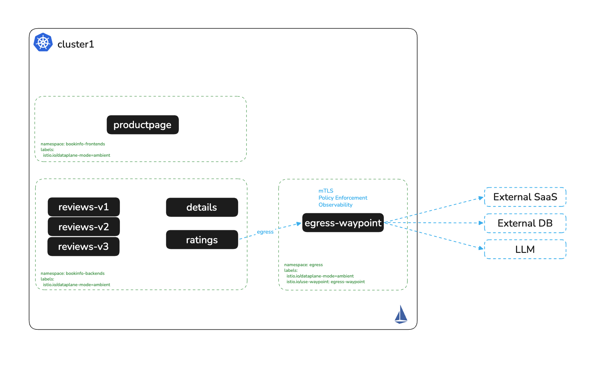

# Send Egress Through Dedicated Nodes with Stable IPs

# Objectives
- Show the source IP that an external service sees for direct egress from each node
- Pin an egress waypoint to a labelled egress node, so every caller leaves from that node's IP
- Route a partner hostname through the egress waypoint with a `ServiceEntry`
- Allow only one identity and one method to reach the partner, with an `AuthorizationPolicy` on the `ServiceEntry`
- Identify the traffic that the egress waypoint does not catch, and how to close that path



## Prerequisites
- This lab assumes you have completed setup from labs `000-015`

Ensure the following environment variables are set:
```bash
export KUBECONTEXT_CLUSTER1=cluster1  # Replace with your actual kubectl context name
export KUBECONTEXT_CLUSTER2=cluster2  # Replace with your actual kubectl context name
```

## Background

When a pod connects to an address outside the cluster, the node it runs on SNATs the connection to the node IP. An external firewall then sees one source IP per node, and a workload's source IP changes every time it moves to another node or another cluster. Firewall rules written for workloads end up listing every node.

An egress waypoint gives all egress for a destination one exit. ztunnel sends traffic for a `ServiceEntry` labelled `istio.io/use-waypoint` to the waypoint over HBONE, and the waypoint opens the external connection. When the waypoint runs only on labelled egress nodes, the external service sees only those nodes' IPs, whichever node or cluster the caller runs on.

| Component | Role in this lab |
|---|---|
| `partner-api` in cluster2, namespace `partner` | The external service. It is outside the mesh, behind a `NodePort`, and prints the source IP it sees |
| A cluster1 node labelled `egress-node=true` | The egress node. Its IP is the address the partner allow-lists |
| `egress-waypoint` in cluster1, namespace `egress` | Runs only on egress nodes, through a `nodeSelector` in its parameters ConfigMap |
| `ServiceEntry` `partner-api.example.com` | Names the partner in the mesh and sends its traffic through `egress-waypoint` |

## Deploy the Partner Service

Deploy the partner in cluster2. `externalTrafficPolicy: Local` keeps the caller's source IP, so the partner reports the address that a real firewall would see:
```bash
kubectl apply --context $KUBECONTEXT_CLUSTER2 -f - <<EOF
apiVersion: v1
kind: Namespace
metadata:
  name: partner
---
apiVersion: apps/v1
kind: Deployment
metadata:
  name: partner-api
  namespace: partner
spec:
  selector:
    matchLabels:
      app: partner-api
  template:
    metadata:
      labels:
        app: partner-api
    spec:
      containers:
      - name: echo
        image: docker.io/istio/app:1.28.10
        args: ["--port", "8080", "--cluster", "partner"]
---
apiVersion: v1
kind: Service
metadata:
  name: partner-api
  namespace: partner
spec:
  type: NodePort
  externalTrafficPolicy: Local
  selector:
    app: partner-api
  ports:
  - name: http
    port: 8080
EOF
kubectl rollout status deploy/partner-api -n partner --watch --timeout=120s --context $KUBECONTEXT_CLUSTER2
export PARTNER_IP=$(kubectl get pod -n partner -l app=partner-api --context $KUBECONTEXT_CLUSTER2 -o jsonpath='{.items[0].status.hostIP}')
export PARTNER_PORT=$(kubectl get svc partner-api -n partner --context $KUBECONTEXT_CLUSTER2 -o jsonpath='{.spec.ports[0].nodePort}')
echo "partner at $PARTNER_IP:$PARTNER_PORT"
```

Expected output (the address differs on your machine):
```
deployment "partner-api" successfully rolled out
partner at 172.30.0.5:30706
```

## Direct Egress Leaves from Each Node

List the cluster1 node IPs, then call the partner directly from `reviews-v1` and from a pod on the other node:
```bash
kubectl get nodes --context $KUBECONTEXT_CLUSTER1 \
  -o jsonpath='{range .items[*]}{.metadata.name} {.status.addresses[?(@.type=="InternalIP")].address}{"\n"}{end}'
REVIEWS_NODE=$(kubectl get pod -n bookinfo-backends -l app=reviews,version=v1 --context $KUBECONTEXT_CLUSTER1 -o jsonpath='{.items[0].spec.nodeName}')
OTHER_NODE=$(kubectl get nodes --context $KUBECONTEXT_CLUSTER1 -o jsonpath='{.items[*].metadata.name}' | tr ' ' '\n' | grep -v "^$REVIEWS_NODE$" | head -1)
kubectl run egress-probe -n default --image=curlimages/curl:8.22.0 --restart=Never \
  --overrides="{\"spec\":{\"nodeName\":\"$OTHER_NODE\"}}" --context $KUBECONTEXT_CLUSTER1 --command -- sleep 600
kubectl wait --for=condition=Ready pod/egress-probe -n default --timeout=60s --context $KUBECONTEXT_CLUSTER1
echo "reviews-v1 on $REVIEWS_NODE: $(kubectl exec deploy/reviews-v1 -n bookinfo-backends --context $KUBECONTEXT_CLUSTER1 -- curl -s -m 5 http://$PARTNER_IP:$PARTNER_PORT/ | grep '^IP=')"
echo "egress-probe on $OTHER_NODE: $(kubectl exec egress-probe -n default --context $KUBECONTEXT_CLUSTER1 -- curl -s -m 5 http://$PARTNER_IP:$PARTNER_PORT/ | grep '^IP=')"
```

Expected output:
```
cluster1 172.30.0.2
worker-1 172.30.0.3
reviews-v1 on worker-1: IP=172.30.0.3
egress-probe on cluster1: IP=172.30.0.2
```

The partner sees the IP of whichever node the caller runs on. Reschedule `reviews-v1`, and its source IP changes.

## Pin an Egress Waypoint to an Egress Node

Label the node that will carry egress. This lab uses the node that does not run `reviews-v1`, so the change is visible. In production, use a dedicated pool of at least two egress nodes, so a node failure does not stop egress:
```bash
export EGRESS_NODE=$OTHER_NODE
kubectl label node $EGRESS_NODE egress-node=true --overwrite --context $KUBECONTEXT_CLUSTER1
```

Create the `egress` namespace and the egress waypoint. The ConfigMap in `spec.infrastructure.parametersRef` adds a `nodeSelector` to the waypoint Deployment that Istio generates:
```bash
kubectl apply --context $KUBECONTEXT_CLUSTER1 -f - <<EOF
apiVersion: v1
kind: Namespace
metadata:
  name: egress
  labels:
    istio.io/dataplane-mode: ambient
---
apiVersion: v1
kind: ConfigMap
metadata:
  name: egress-waypoint-options
  namespace: egress
data:
  deployment: |
    spec:
      template:
        spec:
          nodeSelector:
            egress-node: "true"
---
apiVersion: gateway.networking.k8s.io/v1
kind: Gateway
metadata:
  name: egress-waypoint
  namespace: egress
spec:
  gatewayClassName: istio-waypoint
  infrastructure:
    parametersRef:
      group: ""
      kind: ConfigMap
      name: egress-waypoint-options
  listeners:
  - name: mesh
    port: 15008
    protocol: HBONE
    allowedRoutes:
      namespaces:
        from: All
EOF
kubectl rollout status deploy/egress-waypoint -n egress --watch --timeout=120s --context $KUBECONTEXT_CLUSTER1
kubectl get pods -n egress -o wide --context $KUBECONTEXT_CLUSTER1
```

Expected output (abridged):
```
NAME                               READY   STATUS    RESTARTS   AGE   IP            NODE
egress-waypoint-5644cddc6c-85pxr   1/1     Running   0          8s    10.244.0.17   cluster1
```

## Route the Partner Through the Egress Waypoint

Declare the partner as `partner-api.example.com`. ztunnel's DNS proxy resolves the hostname for mesh callers, and the `istio.io/use-waypoint` label sends the traffic to `egress-waypoint`. The waypoint connects to the partner's address and NodePort:
```bash
kubectl apply --context $KUBECONTEXT_CLUSTER1 -f - <<EOF
apiVersion: networking.istio.io/v1
kind: ServiceEntry
metadata:
  name: partner-api
  namespace: egress
  labels:
    istio.io/use-waypoint: egress-waypoint
spec:
  hosts:
  - partner-api.example.com
  location: MESH_EXTERNAL
  resolution: STATIC
  ports:
  - name: http
    number: 80
    targetPort: $PARTNER_PORT
    protocol: HTTP
  endpoints:
  - address: $PARTNER_IP
EOF
sleep 3
```

Call the partner by hostname from `reviews-v1` and from the probe pod:
```bash
echo "reviews-v1 on $REVIEWS_NODE: $(kubectl exec deploy/reviews-v1 -n bookinfo-backends --context $KUBECONTEXT_CLUSTER1 -- curl -s -m 5 -i http://partner-api.example.com/ | grep -E '^server:|^IP=' | tr -d '\r' | tr '\n' ' ')"
echo "egress-probe on $OTHER_NODE: $(kubectl exec egress-probe -n default --context $KUBECONTEXT_CLUSTER1 -- curl -s -m 5 -i http://partner-api.example.com/ 2>&1 | grep -E '^server:|^IP=|resolve' | tr -d '\r' | tr '\n' ' ')"
```

Expected output:
```
reviews-v1 on worker-1: server: istio-envoy IP=172.30.0.2 
egress-probe on cluster1: 
```

`reviews-v1` runs on `worker-1`, and the partner now sees `172.30.0.2`, the egress node. `server: istio-envoy` shows that the egress waypoint handled the request. The probe pod printed nothing: it runs in the `default` namespace, outside the mesh, so ztunnel's DNS proxy does not serve it and `partner-api.example.com` does not resolve. Only mesh workloads can use the mesh hostname.

## Allow One Identity and One Method

The waypoint enforces `AuthorizationPolicy` resources that target the `ServiceEntry`. Allow only `reviews` to call the partner, and only with `GET`:
```bash
kubectl apply --context $KUBECONTEXT_CLUSTER1 -f - <<EOF
apiVersion: security.istio.io/v1
kind: AuthorizationPolicy
metadata:
  name: partner-api-egress
  namespace: egress
spec:
  targetRefs:
  - kind: ServiceEntry
    group: networking.istio.io
    name: partner-api
  action: ALLOW
  rules:
  - from:
    - source:
        principals:
        - cluster1.local/ns/bookinfo-backends/sa/bookinfo-reviews
    to:
    - operation:
        methods: ["GET"]
EOF
sleep 3
echo "reviews GET:  $(kubectl exec deploy/reviews-v1 -n bookinfo-backends --context $KUBECONTEXT_CLUSTER1 -- curl -s -m 5 -o /dev/null -w '%{http_code}' http://partner-api.example.com/)"
echo "reviews POST: $(kubectl exec deploy/reviews-v1 -n bookinfo-backends --context $KUBECONTEXT_CLUSTER1 -- curl -s -m 5 -X POST -w ' %{http_code}' http://partner-api.example.com/)"
echo "ratings GET:  $(kubectl exec deploy/ratings-v1 -n bookinfo-backends --context $KUBECONTEXT_CLUSTER1 -- curl -s -m 5 -w ' %{http_code}' http://partner-api.example.com/)"
```

Expected output:
```
reviews GET:  200
reviews POST: RBAC: access denied 403
ratings GET:  RBAC: access denied 403
```

The partner's allow-list now has one entry, the egress node IP, and the mesh decides which workloads and methods may use it.

## Close the Direct Path

The egress waypoint handles traffic addressed to `partner-api.example.com`. A workload that connects to the partner's IP and port directly still leaves from its own node:
```bash
echo "reviews-v1 direct to $PARTNER_IP: $(kubectl exec deploy/reviews-v1 -n bookinfo-backends --context $KUBECONTEXT_CLUSTER1 -- curl -s -m 5 http://$PARTNER_IP:$PARTNER_PORT/ | grep '^IP=')"
```

Expected output:
```
reviews-v1 direct to 172.30.0.5: IP=172.30.0.3
```

ztunnel passes the connection through, because no `ServiceEntry` matches the address. Ambient mode applies egress policy to the destinations you declare, and leaves other outbound connections to the network layer. Close the direct path there:

- Allow-list only the egress node IPs on the partner's firewall. A direct connection then arrives from a non-egress node and the partner rejects it, as `172.30.0.3` would be here.
- Block outbound traffic from application pods with a `NetworkPolicy` from your CNI, and allow it only from the `egress` namespace. Flannel, the CNI in the vind clusters this lab was validated on, does not enforce `NetworkPolicy`, so this lab does not apply one.

> **Every cluster and every site gets its own egress nodes.** A workload that moves from cluster1 to cluster2 leaves through cluster2's egress waypoint. Run the same `egress` namespace, ConfigMap, waypoint, `ServiceEntry` and policy in every cluster, and give the partner the egress node IPs of every cluster as one allow-list. That list changes when you add or replace egress nodes, not when workloads move.

> **Cloud VPCs.** Node IPs in a VPC are private. For a destination on the internet, the address the destination sees comes from the VPC's NAT layer, not from the node. Put the egress nodes in their own subnet with its own NAT gateway, or give each egress node a static public IP (an Elastic IP on AWS, a public IP on the NIC in Azure). The egress waypoint pattern is unchanged: it decides which nodes egress traffic leaves from, and the cloud decides which public IP those nodes use.

## Cleanup

Remove the egress waypoint, the `ServiceEntry`, the policy, the probe pod, the node label and the partner:
```bash
kubectl delete namespace egress --context $KUBECONTEXT_CLUSTER1 --ignore-not-found
kubectl delete pod egress-probe -n default --context $KUBECONTEXT_CLUSTER1 --ignore-not-found
kubectl label node -l egress-node=true egress-node- --context $KUBECONTEXT_CLUSTER1
kubectl delete namespace partner --context $KUBECONTEXT_CLUSTER2 --ignore-not-found
```

## Next Steps
At this point we have completed the following objectives:
- Showed the source IP that an external service sees for direct egress from each node
- Pinned an egress waypoint to a labelled egress node, so every caller left from that node's IP
- Routed a partner hostname through the egress waypoint with a `ServiceEntry`
- Allowed only one identity and one method to reach the partner, with an `AuthorizationPolicy` on the `ServiceEntry`
- Identified the traffic that the egress waypoint does not catch, and how to close that path

In the next step `017` we will convert ingress-nginx Ingress objects to Gateway API routes
