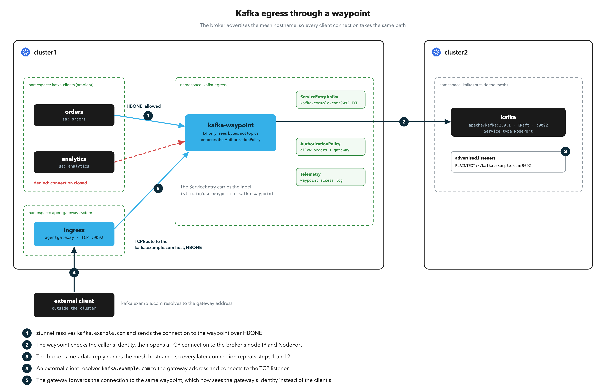

# Send Kafka Egress Through a Waypoint

# Objectives
- Reach a Kafka broker outside the mesh through a `ServiceEntry` with `protocol: TCP`
- Set the broker's advertised listener to the mesh hostname, so every client connection goes through the egress waypoint
- Allow only one identity to reach the broker, with an `AuthorizationPolicy` on the `ServiceEntry`
- Reach the same broker from a client outside the cluster, through the agentgateway ingress with a TCP listener and a `TCPRoute`
- Identify what the waypoint cannot enforce for Kafka, and where that control lives



## Prerequisites
- This lab assumes you have completed setup from labs `000-019`. It uses only the mesh from labs `000-004` and `007`, and the ingress gateway from lab `005` for the last section

Ensure the following environment variables are set:
```bash
export KUBECONTEXT_CLUSTER1=cluster1  # Replace with your actual kubectl context name
export KUBECONTEXT_CLUSTER2=cluster2  # Replace with your actual kubectl context name
```

## Background

Lab `016` routes HTTP to an external partner through an egress waypoint. Kafka differs from HTTP in two ways:

| Property of Kafka | Effect on egress |
|---|---|
| The waypoint sees an opaque TCP stream | The `ServiceEntry` uses `protocol: TCP`. The waypoint authorizes the caller's identity and port. Topics, consumer groups and produce versus fetch are invisible to it |
| A client connects twice | The client opens a bootstrap connection, and the broker answers with the address it advertises. The client then connects to that address for all reads and writes |

The second property decides whether egress control works. If the broker advertises its own IP, the bootstrap connection goes through the waypoint, and every later connection goes straight to the broker. Advertise the mesh hostname instead, and every connection resolves to the `ServiceEntry`.

| Component | Role in this lab |
|---|---|
| `kafka` in cluster2, namespace `kafka` | A single-node KRaft broker outside the mesh, behind a `NodePort`. It advertises `kafka.example.com:9092` |
| `orders` and `analytics` in cluster1, namespace `kafka-clients` | Two clients with different service accounts, enrolled in ambient |
| `kafka-waypoint` in cluster1, namespace `kafka-egress` | The egress waypoint for the broker |
| `ServiceEntry` `kafka.example.com` | Names the broker in the mesh and sends its traffic through `kafka-waypoint` |

## Deploy the Broker

Deploy the broker in cluster2, outside the mesh. `hostAliases` makes the broker resolve its own advertised name to itself, so the Kafka tools inside the pod work. The Service is a `NodePort`, the way a broker in another datacenter would be reached:
```bash
kubectl apply --context $KUBECONTEXT_CLUSTER2 -f - <<EOF
apiVersion: v1
kind: Namespace
metadata:
  name: kafka
---
apiVersion: apps/v1
kind: Deployment
metadata:
  name: kafka
  namespace: kafka
spec:
  selector:
    matchLabels:
      app: kafka
  template:
    metadata:
      labels:
        app: kafka
    spec:
      hostAliases:
      - ip: 127.0.0.1
        hostnames:
        - kafka.example.com
      containers:
      - name: kafka
        image: apache/kafka:3.9.1
        ports:
        - containerPort: 9092
        env:
        - name: KAFKA_NODE_ID
          value: "1"
        - name: KAFKA_PROCESS_ROLES
          value: broker,controller
        - name: KAFKA_LISTENERS
          value: PLAINTEXT://:9092,CONTROLLER://:9093
        # Clients reconnect to this address after the bootstrap call, so it must be the mesh hostname
        - name: KAFKA_ADVERTISED_LISTENERS
          value: PLAINTEXT://kafka.example.com:9092
        - name: KAFKA_CONTROLLER_LISTENER_NAMES
          value: CONTROLLER
        - name: KAFKA_LISTENER_SECURITY_PROTOCOL_MAP
          value: CONTROLLER:PLAINTEXT,PLAINTEXT:PLAINTEXT
        - name: KAFKA_CONTROLLER_QUORUM_VOTERS
          value: 1@localhost:9093
        - name: KAFKA_OFFSETS_TOPIC_REPLICATION_FACTOR
          value: "1"
        - name: KAFKA_TRANSACTION_STATE_LOG_REPLICATION_FACTOR
          value: "1"
        - name: KAFKA_TRANSACTION_STATE_LOG_MIN_ISR
          value: "1"
        - name: KAFKA_AUTO_CREATE_TOPICS_ENABLE
          value: "false"
---
apiVersion: v1
kind: Service
metadata:
  name: kafka
  namespace: kafka
spec:
  type: NodePort
  selector:
    app: kafka
  ports:
  - name: tcp-kafka
    port: 9092
EOF
kubectl rollout status deploy/kafka -n kafka --watch --timeout=180s --context $KUBECONTEXT_CLUSTER2
export KAFKA_IP=$(kubectl get pod -n kafka -l app=kafka --context $KUBECONTEXT_CLUSTER2 -o jsonpath='{.items[0].status.hostIP}')
export KAFKA_PORT=$(kubectl get svc kafka -n kafka --context $KUBECONTEXT_CLUSTER2 -o jsonpath='{.spec.ports[0].nodePort}')
echo "broker at $KAFKA_IP:$KAFKA_PORT"
```

Expected output (the address differs on your machine):
```
deployment "kafka" successfully rolled out
broker at 172.30.0.5:30129
```

Create a topic. The broker takes a few seconds after the rollout to accept connections, so retry until it succeeds:
```bash
for i in $(seq 1 12); do
  kubectl exec deploy/kafka -n kafka --context $KUBECONTEXT_CLUSTER2 -- \
    /opt/kafka/bin/kafka-topics.sh --bootstrap-server kafka.example.com:9092 --create --topic orders && break
  sleep 5
done
```

Expected output (early retries can print `could not be established` warnings first):
```
Created topic orders.
```

## Deploy the Clients

Create the client namespace, enrolled in ambient, with two Deployments that differ only in their service account. The Kafka image carries the console producer, the console consumer and the admin tools:
```bash
kubectl apply --context $KUBECONTEXT_CLUSTER1 -f - <<EOF
apiVersion: v1
kind: Namespace
metadata:
  name: kafka-clients
  labels:
    istio.io/dataplane-mode: ambient
---
apiVersion: v1
kind: ServiceAccount
metadata:
  name: orders
  namespace: kafka-clients
---
apiVersion: v1
kind: ServiceAccount
metadata:
  name: analytics
  namespace: kafka-clients
---
apiVersion: apps/v1
kind: Deployment
metadata:
  name: orders
  namespace: kafka-clients
spec:
  selector:
    matchLabels:
      app: orders
  template:
    metadata:
      labels:
        app: orders
    spec:
      serviceAccountName: orders
      containers:
      - name: client
        image: apache/kafka:3.9.1
        command: ["sleep", "infinity"]
---
apiVersion: apps/v1
kind: Deployment
metadata:
  name: analytics
  namespace: kafka-clients
spec:
  selector:
    matchLabels:
      app: analytics
  template:
    metadata:
      labels:
        app: analytics
    spec:
      serviceAccountName: analytics
      containers:
      - name: client
        image: apache/kafka:3.9.1
        command: ["sleep", "infinity"]
EOF
kubectl rollout status deploy/orders deploy/analytics -n kafka-clients --watch --timeout=180s --context $KUBECONTEXT_CLUSTER1
```

Expected output:
```
deployment "orders" successfully rolled out
deployment "analytics" successfully rolled out
```

## Create the Egress Waypoint and the ServiceEntry

Create the `kafka-egress` namespace and a waypoint. To pin the waypoint to egress nodes for a stable source IP, add the `nodeSelector` ConfigMap from lab `016`:
```bash
kubectl apply --context $KUBECONTEXT_CLUSTER1 -f - <<EOF
apiVersion: v1
kind: Namespace
metadata:
  name: kafka-egress
  labels:
    istio.io/dataplane-mode: ambient
---
apiVersion: gateway.networking.k8s.io/v1
kind: Gateway
metadata:
  name: kafka-waypoint
  namespace: kafka-egress
spec:
  gatewayClassName: istio-waypoint
  listeners:
  - name: mesh
    port: 15008
    protocol: HBONE
    allowedRoutes:
      namespaces:
        from: All
EOF
kubectl rollout status deploy/kafka-waypoint -n kafka-egress --watch --timeout=120s --context $KUBECONTEXT_CLUSTER1
```

Expected output:
```
deployment "kafka-waypoint" successfully rolled out
```

Turn on access logging for the waypoint, as in lab `009`. A TCP waypoint logs one line per connection, which is how you see denied Kafka connections later:
```bash
kubectl apply --context $KUBECONTEXT_CLUSTER1 -f - <<EOF
apiVersion: telemetry.istio.io/v1
kind: Telemetry
metadata:
  name: kafka-waypoint-logging
  namespace: kafka-egress
spec:
  targetRefs:
  - kind: Gateway
    group: gateway.networking.k8s.io
    name: kafka-waypoint
  accessLogging:
  - providers:
    - name: envoy
EOF
sleep 3
```

Declare the broker as `kafka.example.com` on port `9092`. The port uses `protocol: TCP`, so the waypoint forwards the bytes as they are. `targetPort` is the broker's NodePort, and the waypoint connects to it:
```bash
kubectl apply --context $KUBECONTEXT_CLUSTER1 -f - <<EOF
apiVersion: networking.istio.io/v1
kind: ServiceEntry
metadata:
  name: kafka
  namespace: kafka-egress
  labels:
    istio.io/use-waypoint: kafka-waypoint
spec:
  hosts:
  - kafka.example.com
  location: MESH_EXTERNAL
  resolution: STATIC
  ports:
  - name: tcp-kafka
    number: 9092
    targetPort: $KAFKA_PORT
    protocol: TCP
  endpoints:
  - address: $KAFKA_IP
EOF
sleep 5
```

## Produce and Consume Through the Waypoint

Produce a message from `orders`, then read it back from the same pod. Both commands use the mesh hostname as the bootstrap server:
```bash
echo "order-1" | kubectl exec -i deploy/orders -n kafka-clients --context $KUBECONTEXT_CLUSTER1 -- \
  /opt/kafka/bin/kafka-console-producer.sh --bootstrap-server kafka.example.com:9092 --topic orders
kubectl exec deploy/orders -n kafka-clients --context $KUBECONTEXT_CLUSTER1 -- \
  /opt/kafka/bin/kafka-console-consumer.sh --bootstrap-server kafka.example.com:9092 --topic orders \
  --from-beginning --max-messages 1 --timeout-ms 15000
```

Expected output:
```
order-1
Processed a total of 1 messages
```

The message crossed the mesh to the egress waypoint, left cluster1 from the waypoint, and reached a broker that is not in the mesh.

## Why the Advertised Listener Matters

Ask the broker which address it hands to clients:
```bash
kubectl exec deploy/orders -n kafka-clients --context $KUBECONTEXT_CLUSTER1 -- \
  /opt/kafka/bin/kafka-broker-api-versions.sh --bootstrap-server kafka.example.com:9092 | head -1
```

Expected output:
```
kafka.example.com:9092 (id: 1 rack: null) -> (
```

The broker advertises `kafka.example.com:9092`, the same name the clients used to bootstrap. Every later connection resolves through ztunnel's DNS proxy to the `ServiceEntry` and reaches the waypoint.

Had the broker advertised `$KAFKA_IP:$KAFKA_PORT`, the bootstrap would pass through the waypoint and the produce and fetch connections would not. A client that follows the advertised address leaves from its own node, and the waypoint policy in the next section never sees it. Check this setting first when Kafka egress policy appears to do nothing.

> **Several brokers.** Each broker needs its own advertised name and its own `ServiceEntry` host and port, for example `kafka-0.example.com` and `kafka-1.example.com`, because a client connects to the broker that leads each partition. Add one `ServiceEntry` per broker, all with the `istio.io/use-waypoint` label.

## Allow One Identity

The waypoint enforces `AuthorizationPolicy` resources that target the `ServiceEntry`. Allow only the `orders` service account to reach port `9092`:
```bash
kubectl apply --context $KUBECONTEXT_CLUSTER1 -f - <<EOF
apiVersion: security.istio.io/v1
kind: AuthorizationPolicy
metadata:
  name: kafka-egress
  namespace: kafka-egress
spec:
  targetRefs:
  - kind: ServiceEntry
    group: networking.istio.io
    name: kafka
  action: ALLOW
  rules:
  - from:
    - source:
        principals:
        - cluster1.local/ns/kafka-clients/sa/orders
    to:
    - operation:
        ports: ["9092"]
EOF
sleep 5
```

Check both clients. The command lists topics with a 10 second timeout, and prints the topic name on success or the timeout error when the waypoint refuses the connection:
```bash
for CLIENT in orders analytics; do
  echo "$CLIENT: $(kubectl exec deploy/$CLIENT -n kafka-clients --context $KUBECONTEXT_CLUSTER1 -- sh -c '
    printf "request.timeout.ms=5000\ndefault.api.timeout.ms=10000\n" > /tmp/client.properties
    /opt/kafka/bin/kafka-topics.sh --bootstrap-server kafka.example.com:9092 --command-config /tmp/client.properties --list 2>&1 \
      | grep -m1 -oE "^orders$|Timed out waiting for a node assignment"')"
done
```

Expected output:
```
orders: orders
analytics: Timed out waiting for a node assignment
```

`analytics` reaches the waypoint and the waypoint closes the connection, so the Kafka client retries until its timeout. The Kafka error hides the denial, and the waypoint log records it. Show the last denied connection and the last allowed one:
```bash
kubectl logs deploy/kafka-waypoint -n kafka-egress --context $KUBECONTEXT_CLUSTER1 --tail=-1 | grep rbac_access_denied | tail -1
kubectl logs deploy/kafka-waypoint -n kafka-egress --context $KUBECONTEXT_CLUSTER1 --tail=-1 | grep "kafka.example.com" | grep -v rbac_access_denied | tail -1
```

Expected output (addresses and timestamps differ on your machine):
```
[2026-10-28T23:45:05.814Z] "- - -" 0 - - rbac_access_denied_matched_policy[none] "-" 53 0 0 - "-" "-" "-" "-" "172.30.0.5:30129" inbound-vip|9092|tcp|kafka.example.com 10.244.2.53:49936 240.240.0.17:9092 10.244.2.52:56552 - -
[2026-10-28T23:44:55.839Z] "- - -" 0 - - - "-" 85 1995 7 - "-" "-" "-" "-" "172.30.0.5:30129" inbound-vip|9092|tcp|kafka.example.com 10.244.2.53:44094 240.240.0.17:9092 10.244.2.51:52262 - -
```

The first line shows `rbac_access_denied_matched_policy[none]` with no upstream address: the waypoint refused the connection before it opened one to the broker. `[none]` means no `ALLOW` policy matched the caller. The second line is an `orders` connection. It carries the broker's address (`172.30.0.5:30129`) and the bytes it received.

> **What the waypoint cannot enforce.** The waypoint sees only bytes. `orders` can read and write every topic the broker allows it. Per-topic, per-group and produce versus fetch control belongs to Kafka ACLs on the broker, which key off the client's authenticated principal. The waypoint decides which workloads may reach the broker at all, and Kafka ACLs decide what they do there.

## Reach the Broker from Outside Through the Ingress Gateway

A Kafka client outside the cluster can use the same path. The agentgateway ingress from lab `005` accepts the client on a TCP listener and forwards it into the mesh over HBONE, to the `kafka.example.com` `ServiceEntry`. The egress waypoint and its policy then apply as before:

```
external client -> ingress gateway :9092 -> HBONE -> kafka-waypoint -> broker
```

Two details matter for Kafka:

| Detail | Effect |
|---|---|
| The broker advertises `kafka.example.com:9092` | The external client must resolve that name to the gateway address, for the bootstrap call and for every later connection. In production this is a DNS record. In this lab, the client container gets a hosts entry |
| The waypoint authorizes the gateway's identity | The waypoint sees `agentgateway-system/sa/ingress` for every external client and cannot tell them apart |

### Install TCPRoute Support

Gateway API `TCPRoute` ships in the experimental channel, and the agentgateway controller needs Gateway API CRDs `1.6.0` or later to process it. Lab `002` installed the standard channel, which has no `TCPRoute`. Apply the experimental `1.6.0` bundle and restart the controller so that it picks up the new CRD:
```bash
kubectl apply --server-side --force-conflicts --context $KUBECONTEXT_CLUSTER1 \
  -f https://github.com/kubernetes-sigs/gateway-api/releases/download/v1.6.0/experimental-install.yaml
kubectl rollout restart deploy/enterprise-agentgateway -n agentgateway-system --context $KUBECONTEXT_CLUSTER1
kubectl rollout status deploy/enterprise-agentgateway -n agentgateway-system --watch --timeout=120s --context $KUBECONTEXT_CLUSTER1
```

Expected output (the apply prints one `serverside-applied` line per resource first):
```
deployment.apps/enterprise-agentgateway restarted
deployment "enterprise-agentgateway" successfully rolled out
```

> **This replaces the Gateway API CRDs for the whole cluster.** The experimental bundle is a superset of the standard one, and the cleanup lab removes the CRDs with the rest of the workshop. On a shared cluster, check which Gateway API version and channel other controllers expect before you apply it.

### Add a TCP Listener and a TCPRoute

Add a `TCP` listener on port `9092` to the `ingress` Gateway. The listener accepts only `TCPRoute`:
```bash
kubectl patch gateway ingress -n agentgateway-system --context $KUBECONTEXT_CLUSTER1 --type=json -p='[
  {"op": "add", "path": "/spec/listeners/-", "value": {
    "name": "kafka",
    "port": 9092,
    "protocol": "TCP",
    "allowedRoutes": {"namespaces": {"from": "All"}, "kinds": [{"kind": "TCPRoute"}]}
  }}
]'
```

Route the listener to the `kafka.example.com` host. A `Hostname` backend reference from `networking.istio.io` points at the mesh host that the `ServiceEntry` defines, so the gateway sends the connection through the egress waypoint:
```bash
kubectl apply --context $KUBECONTEXT_CLUSTER1 -f - <<EOF
apiVersion: gateway.networking.k8s.io/v1
kind: TCPRoute
metadata:
  name: kafka
  namespace: kafka-egress
spec:
  parentRefs:
  - name: ingress
    namespace: agentgateway-system
    sectionName: kafka
  rules:
  - backendRefs:
    - group: networking.istio.io
      kind: Hostname
      name: kafka.example.com
      port: 9092
EOF
for i in $(seq 1 30); do
  ACCEPTED=$(kubectl get tcproute kafka -n kafka-egress --context $KUBECONTEXT_CLUSTER1 -o jsonpath='{.status.parents[*].conditions[?(@.type=="Accepted")].status}')
  PORTS=$(kubectl get svc ingress -n agentgateway-system --context $KUBECONTEXT_CLUSTER1 -o jsonpath='{.spec.ports[*].port}')
  [ "$ACCEPTED" = "True" ] && echo "$PORTS" | grep -q 9092 && break
  sleep 2
done
kubectl get tcproute kafka -n kafka-egress --context $KUBECONTEXT_CLUSTER1 \
  -o jsonpath='{range .status.parents[0].conditions[*]}{.type}={.status}{"\n"}{end}'
kubectl get svc ingress -n agentgateway-system --context $KUBECONTEXT_CLUSTER1
```

Expected output (addresses differ on your machine):
```
Accepted=True
ResolvedRefs=True
NAME      TYPE           CLUSTER-IP      EXTERNAL-IP      PORT(S)                       AGE
ingress   LoadBalancer   10.101.55.206   172.30.255.251   80:30414/TCP,9092:31865/TCP   13m
```

### Connect an External Client

Read the gateway address. The client below runs in a container outside the cluster, and a hosts entry points `kafka.example.com` at the gateway, the way a DNS record would. The container must reach the gateway address. Set `GATEWAY_DOCKER_NETWORK` to the Docker network that holds the gateway's load balancer, or remove the `--network` flag when your host reaches the address directly:
```bash
export KAFKA_GW_IP=$(kubectl get svc ingress -n agentgateway-system --context $KUBECONTEXT_CLUSTER1 -o jsonpath='{.status.loadBalancer.ingress[0].ip}')
export GATEWAY_DOCKER_NETWORK=vind-mesh  # Replace with the Docker network that holds the gateway address
kafka_external() {
  docker run --rm -i --network $GATEWAY_DOCKER_NETWORK --add-host kafka.example.com:$KAFKA_GW_IP apache/kafka:3.9.1 "$@"
}
echo "gateway at $KAFKA_GW_IP"
```

> **No route from your host to the gateway address?** Forward the gateway port instead, and point the hosts entry at the Docker host: run `kubectl port-forward svc/ingress 9092:9092 -n agentgateway-system --address 0.0.0.0 --context $KUBECONTEXT_CLUSTER1` in another terminal, and define `kafka_external` as `docker run --rm -i --add-host kafka.example.com:host-gateway apache/kafka:3.9.1 "$@"`. The advertised address, `kafka.example.com:9092`, then reaches the forward on every connection.

The `kafka-egress` policy allows only `orders`, so the waypoint refuses the gateway. List the topics with the 10 second timeout from before:
```bash
kafka_external sh -c '
  printf "request.timeout.ms=5000\ndefault.api.timeout.ms=10000\n" > /tmp/client.properties
  /opt/kafka/bin/kafka-topics.sh --bootstrap-server kafka.example.com:9092 --command-config /tmp/client.properties --list 2>&1 \
    | grep -m1 -oE "^orders$|Timed out waiting for a node assignment"'
```

Expected output:
```
Timed out waiting for a node assignment
```

The client reached the gateway, the gateway reached the waypoint, and the waypoint closed the connection because `cluster1.local/ns/agentgateway-system/sa/ingress` is not on the allow list. Add the gateway's identity to the policy:
```bash
kubectl apply --context $KUBECONTEXT_CLUSTER1 -f - <<EOF
apiVersion: security.istio.io/v1
kind: AuthorizationPolicy
metadata:
  name: kafka-egress
  namespace: kafka-egress
spec:
  targetRefs:
  - kind: ServiceEntry
    group: networking.istio.io
    name: kafka
  action: ALLOW
  rules:
  - from:
    - source:
        principals:
        - cluster1.local/ns/kafka-clients/sa/orders
        - cluster1.local/ns/agentgateway-system/sa/ingress
    to:
    - operation:
        ports: ["9092"]
EOF
sleep 5
```

Produce a message from outside, then read both messages back:
```bash
echo "external-1" | kafka_external /opt/kafka/bin/kafka-console-producer.sh --bootstrap-server kafka.example.com:9092 --topic orders
kafka_external /opt/kafka/bin/kafka-console-consumer.sh --bootstrap-server kafka.example.com:9092 --topic orders \
  --from-beginning --max-messages 2 --timeout-ms 15000
```

Expected output:
```
order-1
external-1
Processed a total of 2 messages
```

`order-1` came from the in-mesh client earlier in this lab, and `external-1` came from outside the cluster through the gateway and the egress waypoint.

> **The waypoint cannot tell external clients apart.** Every external client arrives as the gateway's identity. A client that reaches port `9092` on the gateway gets everything that identity gets. Authenticate external clients with Kafka's own authentication (SASL or mutual TLS) and limit them with Kafka ACLs, or restrict who can reach the gateway address.

## Cleanup

Remove the `kafka` listener from the ingress Gateway by restating the `http` listener from lab `005`. Then remove the waypoint, the `ServiceEntry`, the policy, the `TCPRoute`, the clients and the broker:
```bash
kubectl patch gateway ingress -n agentgateway-system --context $KUBECONTEXT_CLUSTER1 --type=merge -p='{"spec": {"listeners": [
  {"name": "http", "port": 80, "protocol": "HTTP", "allowedRoutes": {"namespaces": {"from": "All"}}}
]}}'
kubectl delete namespace kafka-egress kafka-clients --context $KUBECONTEXT_CLUSTER1 --ignore-not-found
kubectl delete namespace kafka --context $KUBECONTEXT_CLUSTER2 --ignore-not-found
```

## Next Steps
At this point we have completed the following objectives:
- Reached a Kafka broker outside the mesh through a `ServiceEntry` with `protocol: TCP`
- Set the broker's advertised listener to the mesh hostname, so every client connection went through the egress waypoint
- Allowed only one identity to reach the broker, with an `AuthorizationPolicy` on the `ServiceEntry`
- Reached the same broker from a client outside the cluster, through the agentgateway ingress with a TCP listener and a `TCPRoute`
- Identified what the waypoint cannot enforce for Kafka, and that Kafka ACLs hold that control

In the next step `021` we will remove everything this workshop created
